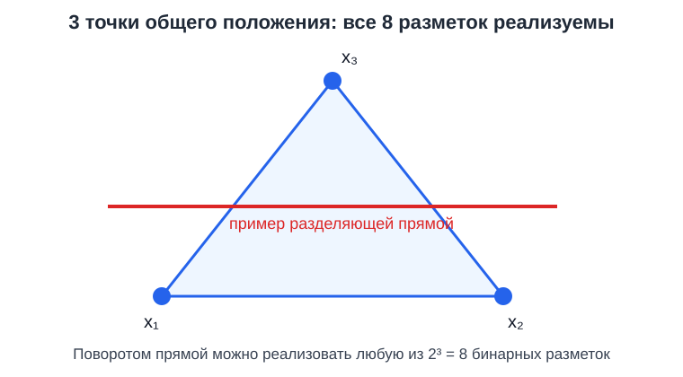
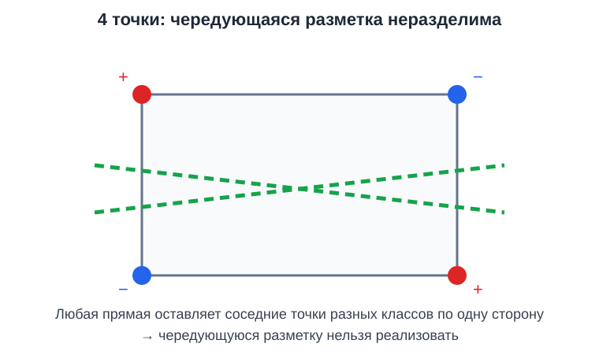

# VC-размерность: подробный разбор

> Входной материал по теме 4 «Математическая теория обобщения и диагностики моделей».

---

## 1. Проблема обобщения

Обозначения:

- $S = \{(x_1,y_1), \ldots,(x_m,y_m)\}$ — обучающая выборка;
- $m$ — число объектов в обучающей выборке;
- $x_i$ — признаки $i$-го объекта;
- $y_i$ — истинная метка $i$-го объекта;
- $f$ — классификатор из рассматриваемого класса функций, а $\hat f$ — функция, выбранная после обучения;
- $\hat{R}_m(\hat f)$ — средняя ошибка $\hat f$ на обучающей выборке, то есть эмпирический риск;
- $R(\hat f)$ — средняя ошибка $\hat f$ на новом случайном объекте, то есть истинный риск.

Сценарий машинного обучения:
1. Собираем обучающую выборку $S$.
2. Обучаем модель и получаем $\hat f$.
3. Сравниваем эмпирический риск $\hat{R}_m(\hat f)$ с истинным риском $R(\hat f)$.

**Проблема:** $\hat{R}_m$ и $R$ могут сильно различаться. Модель может просто «запомнить» обучающую выборку (переобучение) и плохо работать на новых данных. Типичный пример: банк обучил модель выдавать кредиты на 1000 исторических заявках; на обучении ошибка 2%, а на новых заявках — 20%.

**Что делает VC-теория:** даёт математически строгое условие, при котором
$$\hat{R}_m(\hat{f}) \approx R(\hat{f}),$$
то есть обучающая ошибка близка к истинной. Конкретно, теория даёт **верхнюю границу**:
$$
R(\hat f) \leq \hat{R}_m(\hat f) + \sqrt{\frac{h\ln(2em/h)+\ln(4/\delta)}{2m}}.
$$

Здесь $h$ — VC-размерность класса, $\delta$ — допустимая вероятность нарушения гарантии, $e$ — основание натурального логарифма, а $\ln$ — натуральный логарифм. Чем больше $h$, тем шире зазор между обучением и реальностью; чем больше $m$, тем зазор уже.

---

## 2. Краткая историческая справка

**Кратко.** Владимир Вапник и Алексей Червоненкис предложили измерять ёмкость класса функций через способность реализовать все бинарные разметки конечного набора точек. Эта идея стала основой VC-теории обобщения и связывает сложность класса с требуемым размером выборки.

**Владимир Наумович Вапник** (род. 1936) — советский и американский математик, один из создателей статистической теории обучения.
- С 1964 г. работал в Институте проблем управления АН СССР (Москва).
- С 1990 г. — в AT&T Bell Labs (США).
- Соавтор машины опорных векторов (**SVM**, 1995) — одного из самых успешных алгоритмов классического МО.
- Позже — Facebook AI Research и Royal Holloway, University of London.

**Алексей Яковлевич Червоненкис** (1938–2014) — советский и российский математик, также из Института проблем управления РАН. Разработчик методов распознавания образов, применявшихся в геологии, медицине, распознавании рукописного текста.

В 1971 году Вапник и Червоненкис опубликовали работу о **равномерной сходимости частот к вероятностям** — фундамент всей современной теории обучения. В этой работе они ввели понятие «ёмкости класса функций», которое позже назвали **VC-размерностью** в их честь.

Неравенство обобщения называют **неравенством Вапника–Червоненкиса**.

---

## 3. VC-размерность прямых на плоскости

### 3.1. Определение

Для линейного классификатора в $\mathbb{R}^2$ (прямых на плоскости) VC-размерность $h = 3$. Здесь $n$ обозначает число рассматриваемых точек.

По определению VC-размерности:
- **Существует** конфигурация из 3 точек, которую можно разбить (реализовать все $2^3 = 8$ разметок прямой).
- **Не существует** конфигурации из 4 точек, которую можно разбить — всегда найдётся «плохая» разметка.

### 3.2. Полная таблица по числу точек (для прямых на плоскости)

| Число точек $n$ | Можно разбить все $2^n$ разметок? | Почему |
|---|---|---|
| 1 | Да | Прямая справа или слева от точки |
| 2 | Да | Прямая между ними, или с одной стороны |
| 3 (**общего положения**, не на одной прямой) | **Да** | Все 8 разметок реализуемы |
| 4 (любая конфигурация) | **Нет** | Всегда есть «плохая» разметка |
| 5, 6, 7, … | **Нет** | Если не получилось с 4, то и с большим числом не получится |

**Важно:** 5, 6 и более точек **тоже нельзя** разбить прямой на плоскости! Способность разбивать — это реализация **всех** возможных разметок. Если для 4 точек какая-то разметка нереализуема, то для 5 точек нереализуемых разметок будет ещё больше.

### 3.3. Почему 3 точки общего положения можно разбить?

Возьмём 3 точки, не лежащие на одной прямой (треугольник). Переберём все 8 разметок:

| Разметка $(x_1, x_2, x_3)$ | Как провести прямую |
|---|---|
| $(+, +, +)$ | Прямая вне треугольника |
| $(-, -, -)$ | Прямая вне треугольника, с другой стороны |
| $(+, -, -)$ | Прямая отделяет вершину $x_1$ от ребра $x_2 x_3$ |
| $(-, +, +)$ | То же, что и выше, но «+» и «−» поменялись местами |
| $(-, +, -)$ | Прямая отделяет вершину $x_2$ |
| $(+, -, +)$ | Прямая отделяет вершину $x_3$ |
| $(+, +, -)$ | Прямая параллельна ребру $x_1 x_2$, отсекает $x_3$ |
| $(-, -, +)$ | То же, с противоположной стороны |

Все 8 реализуемы. ✓

*Рисунок 1. Для разных разметок положение разделяющей прямой меняется.*

> **Уточнение про «общее положение»:** если 3 точки лежат на одной прямой, разметку $(+, -, +)$ нельзя реализовать (как в 1D-случае). Поэтому говорят «3 точки **общего положения**».

### 3.4. Почему 4 точки нельзя?

Для любых 4 точек на плоскости выполнен один из двух случаев:

**Случай A. Все 4 точки в выпуклой позиции** (образуют выпуклый четырёхугольник).

Возьмём разметку $(+, -, +, -)$ — чередующуюся вокруг периметра. Прямая делит плоскость на 2 полуплоскости. Чтобы получить чередующуюся разметку, надо, чтобы в одной полуплоскости были две точки «+», в другой — две «−». Но вокруг четырёхугольника «+» и «−» чередуются — между любыми двумя «+» есть «−». Значит, прямая не может отделить «+» от «−».

**Случай B. Одна точка внутри треугольника из трёх других.**

Разметка: «+» — внутренняя точка, «−» — три внешние. Прямая, отделяющая внутреннюю точку от всех внешних, невозможна: внутренняя точка лежит в выпуклой оболочке внешних, поэтому любая прямая через неё оставляет хотя бы одну внешнюю точку с той же стороны.

**Итог:** в любой конфигурации из 4 точек найдётся нереализуемая разметка → VC-размерность $\leq 3$. А 3 точки общего положения разбиваются → $h = 3$.

*Рисунок 2. Чередующуюся разметку вершин выпуклого четырёхугольника нельзя разделить одной прямой.*

### 3.5. Простое правило

> Для линейного классификатора в $\mathbb{R}^d$: VC-размерность $h = d + 1$, где $d$ — число признаков.
> - $d = 1$: $h = 2$ (порог на числовой прямой).
> - $d = 2$: $h = 3$ (прямые на плоскости).
> - $d = 3$: $h = 4$ (плоскости в 3D).
> - $d = 10$: $h = 11$ (гиперплоскости в 10D).

---

## 4. VC-размерность и конкретная классификация

Ключевое различие:

| | VC-теория | Практическая задача |
|---|---|---|
| Вопрос | «Может ли модель реализовать **любую** разметку?» | «Хватит ли модели для **конкретной** разметки?» |
| Когда выполняется | Для всех $2^n$ разметок | Для одной фиксированной разметки |
| Связь с данными | Не зависит от разметки, только от класса моделей | Зависит от реальных данных |

В реальной задаче (кредитный скоринг) у нас есть конкретная историческая разметка «выдали/отказали». Если для этой разметки существует разделяющая прямая — модель её найдёт.

VC-теория отвечает на другой вопрос: **даже если на обучении модель работала хорошо, можно ли доверять ей на новых данных?** Ответ: можно, **если данных достаточно**. Насколько достаточно — даёт формула:
$$m \;\geq\; \frac{h \ln(2em/h) + \ln(4/\delta)}{2\varepsilon^2}.$$

Здесь $\varepsilon$ — максимально допустимый зазор между истинным и эмпирическим рисками.

Чем сложнее модель (больше $h$), тем больше данных нужно для надёжного обобщения.

**Аналогия.** Линейка может измерить длину любого предмета, который короче её. VC-размерность = «длина линейки». Если объект больше линейки — линейка не подходит, нужна более «ёмкая».

---

## 5. Вероятностная граница VC

В формуле:
$$R(f) \;\leq\; \hat{R}_m(f) \;+\; \sqrt{\frac{1}{2m}\!\left(h \ln\frac{2em}{h} + \ln\frac{4}{\delta}\right)}, \qquad \text{с вероятностью} \geq 1 - \delta.$$

Здесь:
- $\delta \in (0, 1)$ — допустимая вероятность нарушения оценки.
- Гарантия: с вероятностью $\geq 1 - \delta$ неравенство выполнено.

### Случайность обучающей выборки

Обучающая выборка — **случайная**. На разных выборках получим разные $\hat{R}_m$. Нельзя гарантировать, что для **любой** выборки $\hat{R}_m$ близко к $R$. Но можно гарантировать, что для **большинства** выборок (доли $\geq 1 - \delta$) — близко.

### Численный пример ($m = 100$, $h = 10$)

| $\delta$ | Доверие $1 - \delta$ | $\ln(4/\delta)$ | Зазор |
|---|---|---|---|
| 0,10 | 90% | 3,69 | $\approx 0{,}489$ |
| 0,05 | 95% | 4,38 | $\approx 0{,}496$ |
| 0,01 | 99% | 5,99 | $\approx 0{,}512$ |

Увеличение требуемого доверия уменьшает допустимую вероятность нарушения оценки $\delta$. Поэтому логарифмический член $\ln(4/\delta)$ растёт, и зазор становится шире.

### Почему $\ln(4/\delta)$?

Доказательство VC-теоремы использует неравенство Чернова (или Хёфдинга), которое само по себе вероятностное. Вероятность большого отклонения убывает экспоненциально:

$$
\Pr[\text{отклонение} > t] \leq e^{-2mt^2}.
$$

Если выразить $t$ через $\delta$, получим:

$$
t = \sqrt{\frac{\ln(1/\delta)}{2m}}.
$$

---

## 6. Финансовые задания

### 6.1. Кредитный скоринг с пороговым правилом

**Условие.** Банк принимает решение по одному показателю платёжеспособности $x$: заявка получает одобрение, если $x>a$, и отказ — иначе. Здесь $x$ — значение показателя, а $a$ — порог. Введём класс функций

$$
\mathcal{H} = \{f_a : f_a(x)=\mathrm{sign}(x-a),\ a\in\mathbb{R}\}.
$$

Запись $f_a(x)$ означает: функция $f_a$ получает на вход показатель $x$ и возвращает метку $+1$ или $-1$. Найдите VC-размерность класса функций $\mathcal{H}$.

**Решение.** Одну заявку можно пометить любым из двух способов, выбрав порог слева или справа от неё. Для двух заявок $x_1<x_2$ невозможна разметка «одобрить первую, отказать второй»: один и тот же порог не может одновременно удовлетворять $a<x_1$ и $a>x_2$.

**Ответ:** $h=1$.

---

### 6.2. Интервал допустимого уровня риска

**Условие.** Риск-менеджер одобряет сделку, если показатель $x$ попадает в интервал $[a,b]$, и отклоняет её иначе. Здесь $x$ — показатель сделки, а $a$ и $b$ — левая и правая границы допустимого диапазона. Введём класс функций

$$
f_{a,b}(x)=
\begin{cases}
+1, & x\in[a,b],\\
-1, & x\notin[a,b],
\end{cases}
\qquad a<b.
$$

Класс всех таких функций обозначим через $\mathcal{H}$. Найдите его VC-размерность.

**Решение.** Для двух упорядоченных заявок можно реализовать все четыре разметки: одобрить обе, отклонить обе, одобрить только левую или одобрить только правую. Для трёх точек $x_1<x_2<x_3$ невозможна разметка «одобрить крайние, отклонить среднюю»: интервал, содержащий $x_1$ и $x_3$, содержит и $x_2$.

**Ответ:** $h=2$.

---

### 6.3. Кредитный риск по доходу и долговой нагрузке

**Условие.** Банк одобряет клиента, если пара признаков $(x_1,x_2)$ попадает внутрь прямоугольной области: например, доход находится в допустимом диапазоне, а долговая нагрузка — в другом. Здесь $x_1$ и $x_2$ — два признака клиента, а $a_1,b_1,a_2,b_2$ — границы диапазонов. Введём функции

$$
f_{a_1,b_1,a_2,b_2}(x_1,x_2)=
\begin{cases}
+1, & x_1\in[a_1,b_1]\ \text{и}\ x_2\in[a_2,b_2],\\
-1, & \text{иначе}.
\end{cases}
$$

Класс всех таких функций обозначим через $\mathcal{H}$. Найдите его VC-размерность.

**Решение.** Четыре точки, расположенные как крайние точки знака «+», можно разбить всеми $2^4=16$ разметками. Но если добавить центрального клиента и попытаться одобрить четыре крайние точки, отказав центральному, прямоугольник не справится: он содержит выпуклую оболочку крайних точек, а значит, и центр.

**Ответ:** $h=4$.

---

### 6.4. Периодический торговый сигнал

**Условие.** Торговая стратегия рассматривает момент времени $t$ и классифицирует его по знаку периодического сигнала. Здесь $t$ — время, а $\omega$ — частота сигнала. Рассмотрим класс функций

$$
\mathcal{H} = \{f_\omega : f_\omega(t)=\operatorname{sign}(\sin(\omega t)),\ \omega\in\mathbb{R}\}.
$$

Что можно сказать о VC-размерности?

**Решение.** Хотя параметр один, частота $\omega$ не ограничена. Классический результат показывает, что подходящим выбором $\omega$ можно реализовать разметки наборов произвольного размера. Полное доказательство требует отдельного обоснования.

**Ответ:** $h=\infty$. Одно число параметров не обязано означать малую сложность класса.

---

### 6.5. Сравнение кредитной модели и нейросети

**Условие.** Сравните классы моделей для кредитного скоринга:

1. линейный классификатор по 5 признакам;
2. линейный классификатор по 10 признакам;
3. нейросеть примерно с $10^6$ параметров.

**Решение.** Аффинный линейный классификатор принимает вектор признаков $x\in\mathbb{R}^d$ и вычисляет

$$
f(x)=\operatorname{sign}(w^\top x+b),
$$

где $w$ — вектор весов признаков, $b$ — свободный член (порог), а $d$ — число признаков. Для такого классификатора $h=d+1$: первые две модели имеют $h=6$ и $h=11$. Для нейросети число порядка $10^6$ можно использовать только как грубую архитектурную оценку; точная VC-оценка зависит от структуры и ограничений весов.

**Ответ:** при прочих равных VC-граница для более ёмкого класса шире, но для современных нейросетей такая оценка часто оказывается слишком консервативной.

---

### 6.6. Сколько кредитных заявок нужно собрать?

**Условие.** Линейная модель ипотечного скоринга использует $d=20$ признаков, поэтому $h=21$. Требуются допустимый зазор $\varepsilon=0{,}05$ и доверие 95%, то есть $\delta=0{,}05$. Оцените необходимый размер исторической выборки.

**Решение.** Используем неявное уравнение

$$
\varepsilon \geq \sqrt{\frac{h\ln(2em/h)+\ln(4/\delta)}{2m}}.
$$

Итерационное решение даёт $m\approx39\,700$.

**Ответ:** порядка **40 000 ипотечных заявок** при данной теоретической гарантии.

---

### 6.7. Как меняется гарантия при разной уверенности?

**Условие.** Для модели антифрода $m=1000$, $h=11$, эмпирическая ошибка $\hat{R}_m=0{,}05$. Найдите верхнюю оценку истинной ошибки при доверии 90%, 95% и 99%.

**Решение.** Подстановка $\delta=0{,}10$, $0{,}05$ и $0{,}01$ даёт соответственно:

- $R\le0{,}240$ с вероятностью 90%;
- $R\le0{,}240$ с вероятностью 95%;
- $R\le0{,}243$ с вероятностью 99%.

**Ответ:** повышение уверенности немного расширяет зазор, поскольку $\delta$ входит под логарифм.

---

### 6.8. Модель для малого и крупного банка

**Условие.** Сравните верхнюю границу ошибки при $m=500$, $\hat{R}_m=0{,}05$, $\delta=0{,}05$ для моделей с $h\in\{3,11,21,100\}$. Интерпретируйте результат для банковских моделей разной сложности.

**Решение.** Получаем примерно:

| $h$ | Верхняя оценка $R$ |
|---:|---:|
| 3 | 0,207 |
| 11 | 0,306 |
| 21 | 0,376 |
| 100 | 0,628 |

**Ответ:** при одинаковом размере выборки более сложная модель получает более широкий зазор. В прикладной задаче это аргумент в пользу увеличения данных, регуляризации или более простого класса моделей.

## 7. Сводка

| Вопрос | Краткий ответ |
|---|---|
| В чём проблема? | Гарантировать, что обученная модель работает на новых данных (обобщение). |
| Кто такие Вапник и Червоненкис? | Советские математики, в 1971 г. создали теорию равномерной сходимости и ввели VC-размерность. |
| 3 точки можно, 4 — нельзя, а 5, 6? | 5, 6 и более — тоже нельзя. VC-размерность прямых в $\mathbb{R}^2$ равна 3 — это максимум, который можно разбить. |
| Как тогда делить на классы? | VC — про **любую** разметку. На практике разметка одна конкретная, и если для неё есть разделяющая прямая — модель её найдёт. |
| Есть ли вероятность в формуле? | Да, $\delta$ — вероятность того, что оценка не выполняется. Гарантия: с вероятностью $\geq 1 - \delta$ неравенство верно. |

---

## 8. Памятка

$$h(\text{линейный классификатор в } \mathbb{R}^d) = d + 1$$

$$R(f) \leq \hat{R}_m(f) + \sqrt{\frac{h \ln(2em/h) + \ln(4/\delta)}{2m}} \quad\text{с вероятностью}\quad \geq 1 - \delta$$

- $h$ — VC-размерность (ёмкость модели).
- $m$ — размер обучающей выборки.
- $\delta$ — допустимая вероятность ошибки в оценке (например, 0,05 → 95% гарантия).
- $\hat{R}_m$ — ошибка на обучении.
- $R$ — истинная ошибка на новых данных.

---

## 9. Словарь терминов

| Термин | Краткое определение | Роль в семинаре |
|---|---|---|
| Обобщение | Способность модели сохранять качество на новых данных. | Главная цель анализа после обучения. |
| Эмпирический риск $\hat{R}_m(f)$ | Средняя ошибка функции $f$ на обучающей выборке из $m$ объектов. | Наблюдаемая ошибка в границе. |
| Истинный риск $R(f)$ | Ожидаемая ошибка на новом случайном объекте. | Величина, которую нужно оценить. |
| Класс гипотез $\mathcal{H}$ | Множество функций-классификаторов, из которых выбирается модель. | Объект, чью ёмкость измеряет VC-размерность. |
| VC-размерность $h$ | Наибольшее число точек, для которого существует конфигурация, реализующая все $2^n$ бинарных разметок. | Мера ёмкости класса. |
| Разбиваемость (shattering) | Реализация классом всех возможных бинарных разметок фиксированного набора точек. | Операционное определение VC-размерности. |
| Разметка | Набор меток, например $(+1,-1,+1)$. | Конкретный вариант задания классов точкам. |
| Линейный классификатор | Функция вида $\operatorname{sign}(w^\top x+b)$. | Для аффинных гиперплоскостей в $\mathbb{R}^d$ обычно $h=d+1$. |
| Гиперплоскость | Граница $w^\top x+b=0$, разделяющая пространство на две полуплоскости. | Разделяющая поверхность линейного классификатора. |
| Выпуклая оболочка | Наименьшее выпуклое множество, содержащее заданные точки. | Объясняет невозможность отделить внутреннюю точку от внешних. |
| Индикатор множества | Функция, принимающая одно значение внутри множества и другое вне его. | Используется для интервалов и прямоугольников. |
| Зазор | Разность между верхней оценкой истинного риска и эмпирическим риском. | Растёт с ёмкостью и уменьшается с ростом выборки. |
| $\delta$ | Вероятность нарушения вероятностной гарантии. | Гарантия оценки равна $1-\delta$. |
| $\varepsilon$ | Допустимый размер зазора или требуемая точность. | Используется при расчёте необходимого размера выборки. |
| Равномерная сходимость | Одновременная близость эмпирических и истинных рисков для всех функций класса. | Теоретическая основа VC-оценок. |

> **Замечание.** $h$ — VC-размерность класса, $m$ — размер обучающей выборки, $R(f)$ — истинный риск, а $\hat{R}_m(f)$ — эмпирический риск.
