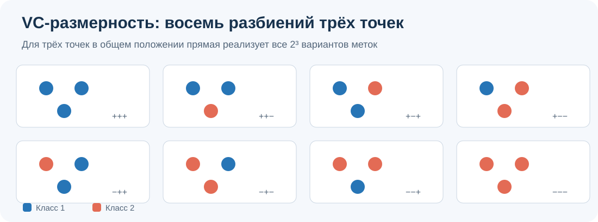
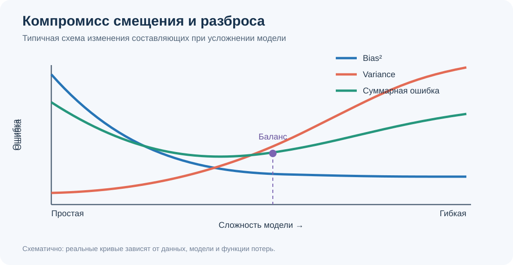
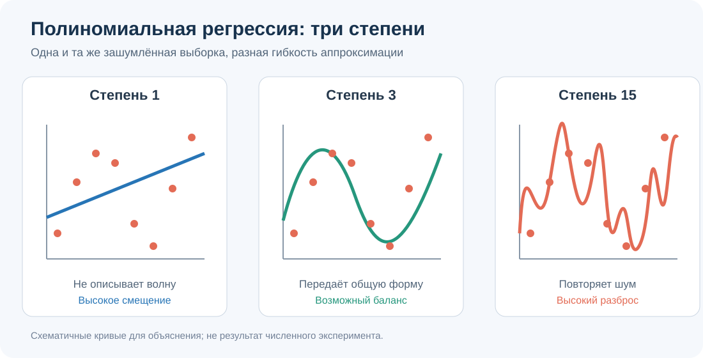
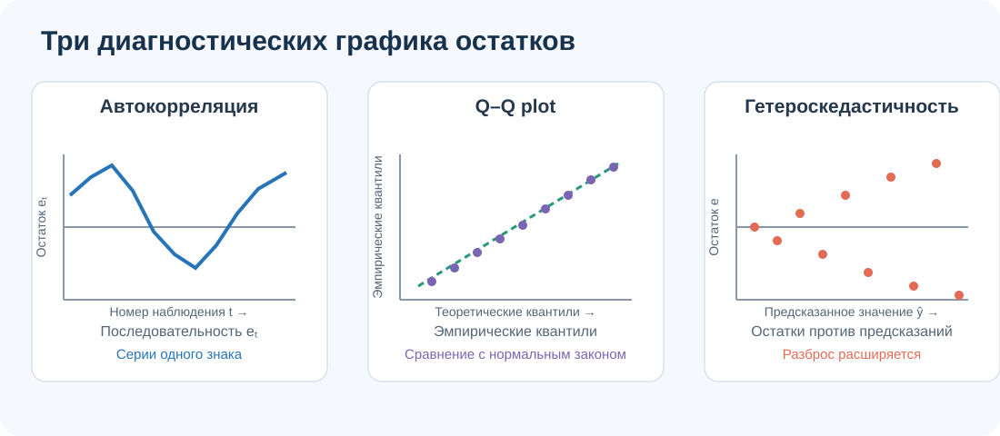
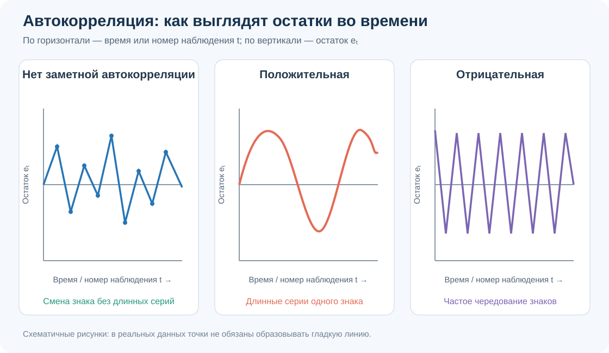
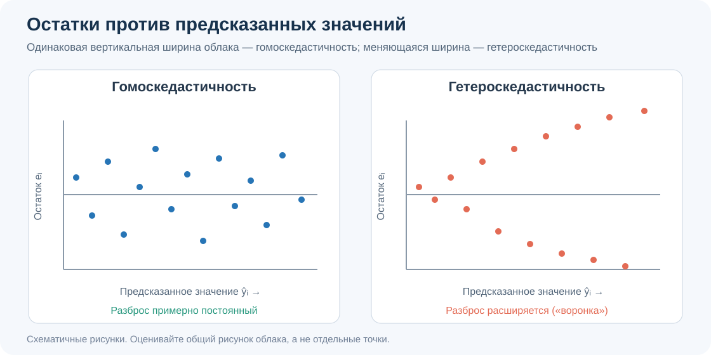
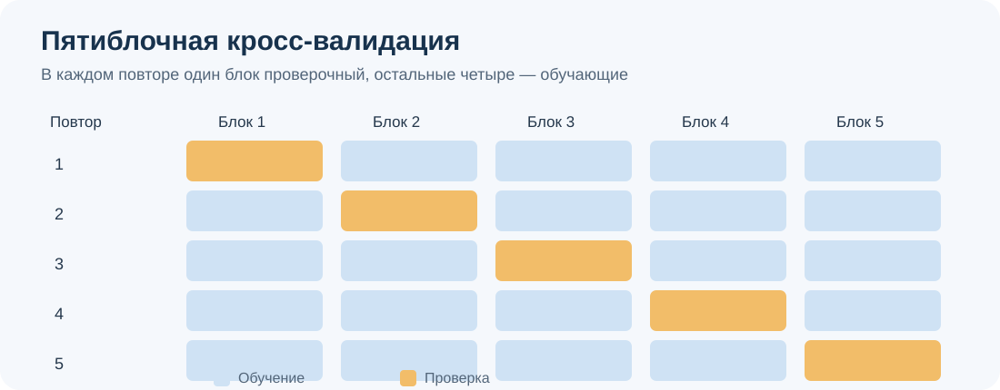
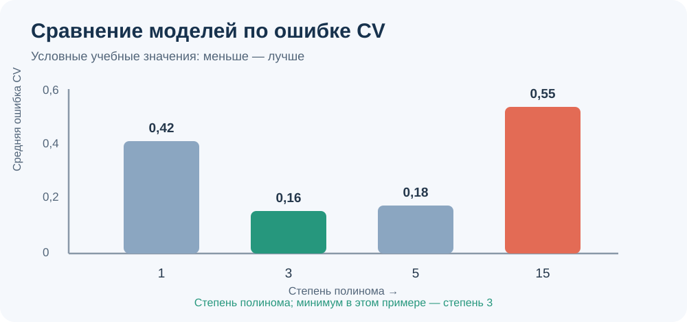

# Bias–variance, анализ остатков и оценка обобщающей способности

**Уровень: 1 курс**

## План лекции

1. Повторение: VC-размерность и сложность Радемахера.
2. Декомпозиция Bias–Variance для квадратичной ошибки.
3. Полиномиальная регрессия: визуализация компромисса.
4. Анализ остатков: автокорреляция, тест Дарбина–Уотсона, Q–Q plot и гетероскедастичность.
5. Кросс-валидация.
6. Эмпирическая оценка и теоретические границы обобщения.
7. Итоги.

---

## 1. Повторение: сложность модели и обобщение

На предыдущих занятиях мы изучали, почему модель может хорошо описывать обучающие данные, но ошибаться на новых. Вспомним два понятия, которые помогают оценивать способность модели к обобщению: **VC-размерность** и **сложность Радемахера**.

### 1.1. VC-размерность

VC-размерность (Vapnik–Chervonenkis dimension) характеризует выразительную способность класса моделей. Интуитивно она показывает, сколько точек можно расположить так, чтобы модель данного класса могла реализовать **любое** возможное разбиение этих точек на два класса. Это свойство называют *shattering*.

Для линейных классификаторов на плоскости VC-размерность равна 3. Три точки, не лежащие на одной прямой, можно разделить прямой всеми $2^3=8$ способами. Для четырёх точек в общем положении уже не каждое разбиение реализуемо прямой.

**Главная мысль:** большая VC-размерность означает, что класс моделей потенциально способен описывать более сложные зависимости. Но высокая гибкость повышает риск подгонки под особенности конкретной обучающей выборки.

### 1.2. Сложность Радемахера

Сложность Радемахера оценивает, насколько хорошо класс моделей способен подстраиваться под случайные метки. Объектам выборки мысленно назначают случайные знаки $+1$ и $-1$, а затем оценивают, насколько хорошо модели из класса могут их воспроизвести.

Эмпирическая сложность Радемахера:

$$
\widehat{\mathfrak R}_n(\mathcal F)
=
\mathbb E_{\sigma}
\left[
\sup_{f\in\mathcal F}
\frac{1}{n}\sum_{i=1}^{n}\sigma_i f(x_i)
\right].
$$

Здесь $\sigma_i$ — независимые случайные знаки $+1$ или $-1$; $\mathcal F$ — класс моделей; $\sup$ означает выбор модели, которая лучше всего подстраивается под эти знаки.

Если класс хорошо подгоняет даже случайные метки, его сложность Радемахера велика. Это сигнал, что без достаточного объёма данных и регуляризации модель может переобучаться.

**Связь понятий:** VC-размерность характеризует выразительную способность класса в целом, а сложность Радемахера — способность класса подстраиваться под случайность на конкретной выборке. Оба понятия используются в теории обобщения, но сами по себе не говорят, насколько хорошо конкретная обученная модель предсказывает новые значения.

**Переход:** далее рассмотрим компромисс между смещением и разбросом, проверим остатки модели и оценим качество на новых данных с помощью кросс-валидации.

---

## 2. Декомпозиция Bias–Variance для квадратичной ошибки

### 2.1. Модель наблюдений

Пусть зависимость между признаками и ответом имеет вид:

$$
y=f(x)+\varepsilon,
$$

где $f(x)$ — неизвестная закономерность, а $\varepsilon$ — случайный шум. Предположим:

$$
\mathbb E[\varepsilon\mid x]=0,
\qquad
\operatorname{Var}(\varepsilon\mid x)=\sigma^2.
$$

Мы обучаем модель на случайной обучающей выборке $D$ и получаем предсказание $\widehat f_D(x)$. Если взять другую обучающую выборку, модель может получиться другой.

Рассмотрим ожидаемую квадратичную ошибку в точке $x$:

$$
\mathbb E_D\left[(y-\widehat f_D(x))^2\mid x\right].
$$

Здесь $D$ — случайная обучающая выборка; $\widehat f_D(x)$ — предсказание модели, обученной на выборке $D$; $y$ — новое наблюдаемое значение при признаке $x$. Ожидание берётся по возможным обучающим выборкам и по шуму в новом наблюдении.

### 2.2. Вывод декомпозиции

Добавим и вычтем среднее предсказание $\mathbb E_D[\widehat f_D(x)]$. Тогда ошибка раскладывается на шум, отклонение среднего предсказания от истинной функции и отклонение конкретного предсказания от среднего:

$$
\begin{aligned}
y-\widehat f_D(x)
&=y-f(x)+f(x)-\mathbb E_D[\widehat f_D(x)]\\
&\quad+\mathbb E_D[\widehat f_D(x)]-\widehat f_D(x).
\end{aligned}
$$

После возведения в квадрат и усреднения смешанные слагаемые исчезают: шум имеет нулевое условное среднее, а отклонение предсказания от собственного среднего также имеет нулевое среднее.

Получаем:

$
\begin{aligned}
\mathbb E_D\left[(y-\widehat f_D(x))^2\mid x\right]
&= \mathrm{Bias}^2(x) \\
&\quad + \mathrm{Var}(\widehat f_D(x)) + \sigma^2.
\end{aligned}
$

Где смещение:

$$
\operatorname{Bias}(x)
=
\mathbb E_D[\widehat f_D(x)]-f(x),
$$

а разброс предсказаний:

$$
\operatorname{Var}(\widehat f_D(x))
=
\mathbb E_D\left[
\left(\widehat f_D(x)-\mathbb E_D[\widehat f_D(x)]\right)^2
\right].
$$

**Смысл формулы:**

- **Bias² (квадрат смещения)** — насколько среднее предсказание отличается от истинной закономерности. Слишком простая модель часто имеет большое смещение.
- **Variance (разброс)** — насколько сильно меняются предсказания, если обучить модель на другой выборке. Слишком гибкая модель может иметь большой разброс.
- **Noise (шум)** — случайная составляющая данных, которую нельзя устранить простым усложнением модели.

Для одной точки сумма трёх составляющих даёт ожидаемую квадратичную ошибку. Для всей задачи значения дополнительно усредняют по распределению признака $X$.

При усложнении модели смещение обычно уменьшается, а разброс увеличивается. Поэтому минимальная ошибка достигается не обязательно у самой простой или самой сложной модели: нужно найти разумный баланс.

---

## 3. Полиномиальная регрессия: визуализация

### 3.1. Пример полиномиальной регрессии

Предположим, данные получены из зависимости:

$$
y=\sin(2\pi x)+\varepsilon,
\qquad
\varepsilon\sim\mathcal N(0,0.1^2).
$$

Мы наблюдаем отдельные зашумлённые точки и пытаемся восстановить исходную зависимость полиномом:

$
\begin{aligned}
\widehat y &= \beta_0+\beta_1x+\beta_2x^2 \\
&\quad + \ldots + \beta_dx^d.
\end{aligned}
$

Здесь: $\widehat y$ — предсказанное значение зависимой переменной; $x$ — значение признака; $\beta_0$ — свободный член; $\beta_1,\ldots,\beta_d$ — коэффициенты модели; $d$ — степень полинома. Чем больше $d$, тем более гибкую кривую может построить модель.

### 3.2. Интерпретация

- **Степень 1.** Прямая не может хорошо описать волнообразную зависимость. Модель систематически ошибается: смещение велико, разброс обычно невелик.
- **Степень 3.** Кривая передаёт основную форму зависимости, не повторяя каждое случайное колебание. Это может быть разумным компромиссом.
- **Степень 15.** Гибкая кривая способна пройти близко к обучающим точкам, включая шум. При изменении состава выборки её форма может сильно измениться: разброс велик.

**Вопрос студентам:** если полином 15-й степени проходит почти через все обучающие точки, означает ли это, что он лучше полинома 3-й степени? Почему?

Ожидаемый ответ: нет. Нужно проверить, насколько хорошо каждая модель предсказывает новые наблюдения.

---

## 4. Анализ остатков регрессионной модели

Кривая обучения и тестовая ошибка показывают общее качество предсказаний. Но они не объясняют, какую структуру модель оставила в ошибках. Для этого анализируют остатки.

### 4.1. Остаток

Для наблюдения $i$:

$$
e_i=y_i-\widehat y_i.
$$

Здесь $e_i$ — остаток для наблюдения $i$; $y_i$ — фактическое значение; $\widehat y_i$ — предсказанное значение; $i$ — номер наблюдения. Остаток — разность между фактическим и предсказанным значением. В диагностике проверяют, связаны ли соседние остатки, похоже ли их распределение на нормальное и меняется ли разброс в зависимости от уровня предсказания.

### 4.2. Автокорреляция и тест Дарбина–Уотсона

**Автокорреляция** — это связь ошибки в одном наблюдении с ошибкой в другом наблюдении, которое расположено рядом с ним в заданном порядке. Чаще всего в этой теме рассматривают временной порядок: месяцы, кварталы, дни или последовательные измерения.

Например, если модель недооценила выручку в одном месяце, а в следующем месяце тоже недооценила её, остатки могут быть положительными несколько периодов подряд. Это означает, что в ошибках осталась временная закономерность, которую модель не объяснила.

**Что смотреть на графике остатков по времени?**

По горизонтальной оси откладывают время или номер наблюдения (t), по вертикальной — остаток (e_t). Через ноль проводят горизонтальную линию.

- **Нет заметной автокорреляции:** остатки хаотично колеблются выше и ниже нуля; длинных серий положительных или отрицательных значений и регулярных волн не видно.
- **Положительная автокорреляция:** соседние остатки часто имеют один знак. На графике видны длинные участки выше нуля, затем ниже нуля; линия выглядит плавной, с инерцией.
- **Отрицательная автокорреляция:** соседние остатки часто меняют знак. На графике заметно чередование «плюс — минус — плюс — минус», возникает частое зигзагообразное движение.

Сам по себе график помогает заметить структуру, но не даёт формального решения. Для проверки автокорреляции первого порядка используют статистику Дарбина–Уотсона.

**Статистика Дарбина–Уотсона:**

$$
DW =
\frac{\sum_{t=2}^{n}(e_t-e_{t-1})^2}
     {\sum_{t=1}^{n}e_t^2}.
$$

Здесь:
- (DW) — статистика Дарбина–Уотсона;
- (e_t) — остаток для наблюдения с номером (t);
- (e_{t-1}) — остаток в предыдущем наблюдении;
- (n) — число наблюдений.

В числителе суммируются квадраты разностей соседних остатков. Если соседние остатки похожи и имеют один знак, разности обычно небольшие, поэтому (DW) уменьшается. Если знаки часто чередуются, разности становятся большими, и (DW) увеличивается.

**Ориентировочная интерпретация:**

| Значение DW | Что это может означать |
|---:|---|
| Близко к 0 | Сильная положительная автокорреляция первого порядка |
| Близко к 2 | Выраженной автокорреляции первого порядка не видно |
| Близко к 4 | Сильная отрицательная автокорреляция первого порядка |

Приближённая связь статистики с выборочной автокорреляцией первого порядка:

$$
DW \approx 2(1-r_1).
$$

Здесь (r_1) — выборочная автокорреляция остатков первого порядка, то есть связь между соседними остатками (e_t) и (e_{t-1}). Например, если (r_1) положительна, (DW) обычно меньше 2; если (r_1) отрицательна, (DW) обычно больше 2.

**Как принимают статистическое решение?** Проверяют нулевую гипотезу (H_0): автокорреляция первого порядка отсутствует. Для формального теста значение (DW) сравнивают с критическими границами (d_L) и (d_U), которые зависят от объёма выборки, числа факторов и уровня значимости. Одного правила «DW близко к 2» достаточно для первичной диагностики, но не для строгого статистического вывода.

Тест применяют к наблюдениям, имеющим осмысленный порядок. Он проверяет автокорреляцию первого порядка и не заменяет анализ графика остатков или проверку других лагов. В частности, график может выявить сезонную волну или более сложную зависимость, которую один показатель DW не описывает.

### 4.3. Q–Q plot: проверка формы распределения

Q–Q plot (quantile–quantile plot) сопоставляет квантили фактических остатков с квантилями выбранного теоретического распределения, обычно нормального.

- Точки примерно лежат на прямой — распределение остатков близко к нормальному.
- Заметное искривление — возможное отличие от нормального распределения.
- Сильные отклонения на концах — возможные тяжёлые хвосты или выбросы.

Нормальность остатков не является условием несмещённости оценок МНК. Она важна прежде всего для точности классических выводов о распределении статистик в малых выборках. Q–Q plot нужно рассматривать вместе с другими диагностическими инструментами.

### 4.4. Гомоскедастичность и гетероскедастичность

Важное предположение линейной регрессии состоит в том, что **разброс ошибок примерно одинаков для разных наблюдений**. Это называют гомоскедастичностью.

$$
\operatorname{Var}(\varepsilon_i\mid X)=\sigma^2.
$$

Здесь:
- (\varepsilon_i) — случайная ошибка для наблюдения (i);
- (X) — набор значений факторов (признаков) в модели;
- (\operatorname{Var}(\varepsilon_i\mid X)) — дисперсия ошибки при заданных значениях факторов;
- (\sigma^2) — одна и та же постоянная дисперсия для всех наблюдений.

**Что значит «дисперсия зависит от наблюдения или уровня признака»?** Это значит, что точность прогноза неодинакова в разных частях данных. Например, модель может ошибаться на небольшую величину для объектов с низким доходом, но гораздо сильнее — для объектов с высоким доходом. Тогда разброс ошибок растёт вместе с доходом. Или, например, ошибки могут быть больше у крупных компаний, чем у небольших.

В таком случае дисперсия ошибки меняется от наблюдения к наблюдению:

$$
\operatorname{Var}(\varepsilon_i\mid X)=\sigma_i^2.
$$

Здесь (\sigma_i^2) — дисперсия ошибки именно для наблюдения (i); она может быть больше или меньше в зависимости от значений признаков. Это называется **гетероскедастичностью**.

**Какой график нужен?** Да, нужен график остатков против предсказанных значений. На горизонтальной оси — предсказанное моделью значение (\widehat y_i), на вертикальной — остаток (e_i=y_i-\widehat y_i). Горизонтальная линия на уровне нуля служит ориентиром.

- **Гомоскедастичность:** точки образуют облако примерно одинаковой вертикальной ширины по всей оси (\widehat y). Разброс ошибок не увеличивается и не уменьшается систематически.
- **Гетероскедастичность:** облако меняет ширину. Частый пример — «воронка»: слева точки расположены близко друг к другу, а справа разброс постепенно расширяется. Возможна и обратная воронка — разброс уменьшается.
- **Важно:** отдельные точки могут выходить далеко от нуля и при гомоскедастичности. Важен не сам факт больших остатков, а систематическое изменение их разброса по оси предсказаний или признака.

### 4.5. Тест Бройша–Пагана

Нулевая гипотеза:

$$
H_0:\operatorname{Var}(\varepsilon_i\mid X)=\sigma^2.
$$

Вспомогательная регрессия квадратов остатков на факторы:

$$
e_i^2=\alpha_0+\alpha_1x_{i1}+\ldots+\alpha_px_{ip}+u_i.
$$

Статистика LM:

$$
LM=nR^2\sim\chi_p^2,
$$

Здесь $LM$ — статистика теста; $n$ — число наблюдений; $R^2$ — коэффициент детерминации вспомогательной регрессии; $\chi_p^2$ — распределение хи-квадрат с $p$ степенями свободы; $p$ — число объясняющих переменных без константы.

При уровне значимости 5%:

- если $p\text{-value}<0.05$, отвергаем гипотезу постоянной дисперсии;
- если $p\text{-value}\geq0.05$, недостаточно оснований её отвергнуть.

Неотвержение нулевой гипотезы не доказывает, что гетероскедастичности нет.

Что делать при гетероскедастичности? Использовать робастные стандартные ошибки, взвешенный МНК (WLS), преобразование переменных или пересмотреть спецификацию модели. Робастные стандартные ошибки не устраняют неодинаковую дисперсию, но позволяют корректнее оценивать неопределённость коэффициентов при подходящих условиях.

### 4.6. Три диагностики — три разных вопроса

| Инструмент | На какой вопрос отвечает |
|---|---|
| Дарбин–Уотсон | Есть ли автокорреляция первого порядка? |
| Q–Q plot | Насколько распределение остатков похоже на нормальное? |
| График остатков и тест Бройша–Пагана | Меняется ли дисперсия ошибок? |

Ни один из этих инструментов не заменяет два других.

---

## 5. Кросс-валидация

### 5.1. Зачем нужна кросс-валидация

Результат одной проверки может зависеть от того, какие наблюдения попали в тестовую выборку. Кросс-валидация повторяет оценку на нескольких разбиениях данных и даёт более устойчивую оценку качества.

### 5.2. K-fold cross-validation

Разделим данные на $K$ примерно равных частей — блоков (folds). В каждом повторе один блок используем для проверки, остальные $K-1$ блоков — для обучения. После $K$ повторов каждый объект один раз побывает в проверочной части.

Средняя ошибка кросс-валидации:

$$
CV_K=\frac{1}{K}\sum_{k=1}^{K}L_k.
$$

Здесь $CV_K$ — средняя ошибка кросс-валидации; $K$ — число блоков; $L_k$ — ошибка на проверочном блоке в повторе $k$; $k$ — номер повтора.

### 5.3. Числовой пример

Пять проверочных ошибок равны $4,5,3,6,2$. Тогда:

$$
CV_5=\frac{4+5+3+6+2}{5}=4.
$$

### 5.4. Сравнение моделей

Предположим, сравниваем полиномы разных степеней:

| Степень полинома | Средняя ошибка CV |
|---:|---:|
| 1 | 0,42 |
| 3 | 0,16 |
| 5 | 0,18 |
| 15 | 0,55 |

В этом примере наименьшая средняя ошибка у полинома 3-й степени.

Если кросс-валидация используется для выбора модели и настройки параметров, окончательную оценку качества лучше получить на отдельной тестовой выборке, не участвовавшей в выборе. Иначе тестовые данные постепенно становятся частью настройки.

**Утечка данных (data leakage).** Информация из проверочной или тестовой части попадает в обучение или предварительную обработку. Например, стандартизацию признаков нужно обучать только на обучающей части каждого разбиения.

**Временные данные.** Случайное перемешивание может привести к тому, что модель обучается на будущем и проверяется на прошлом. Для временных рядов используют разбиение с сохранением порядка времени.

---

## 6. Кросс-валидация и теоретические границы обобщения

Кросс-валидация и теория обобщения связаны, но отвечают на разные вопросы:

- **Кросс-валидация** даёт эмпирическую оценку ошибки на отложенных частях имеющейся выборки.
- **Теоретическая граница** при заданных предположениях ограничивает возможное отличие истинного риска от эмпирического риска с определённой вероятностью.

### 6.1. Истинный и эмпирический риск

Истинный риск — ожидаемая ошибка модели на новых наблюдениях из того же распределения:

$$
R(f)=\mathbb E_{(X,Y)}[\ell(f(X),Y)].
$$

Эмпирический риск — средняя ошибка на имеющейся выборке:

$$
\widehat R_n(f)=\frac{1}{n}\sum_{i=1}^{n}\ell(f(x_i),y_i).
$$

Зазор обобщения:

$$
G_n(f)=R(f)-\widehat R_n(f).
$$

Мы хотим, чтобы эмпирический риск был близок к истинному, то есть чтобы зазор не был слишком большим.

### 6.2. Пример границы Хёффдинга

Если функция потерь независимых наблюдений ограничена интервалом $[0,1]$, то для заранее фиксированной модели можно использовать неравенство Хёффдинга:

$$
\Pr\left(
|R(f)-\widehat R_n(f)|\geq\varepsilon
\right)
\leq 2\exp(-2n\varepsilon^2).
$$

С вероятностью не менее $1-\delta$:

$$
|R(f)-\widehat R_n(f)|
\leq
\sqrt{\frac{\ln(2/\delta)}{2n}}.
$$

Пусть $n=1000$, $\delta=0.05$, а эмпирический риск равен $0.10$. Тогда:

$$
\varepsilon=
\sqrt{\frac{\ln(40)}{2000}}
\approx 0.043.
$$

В рамках условий этой границы истинный риск не превышает примерно $0.10+0.043=0.143$ с вероятностью не менее 95%.

**Ограничение:** обычная квадратичная ошибка не ограничена сверху. Поэтому эту форму неравенства нельзя напрямую применять к MSE без дополнительных условий, например ограничения значений или использования другой концентрационной оценки.

### 6.3. Связь с VC-размерностью и сложностью Радемахера

Если мы выбираем лучшую модель из большого класса после просмотра данных, границы для одной заранее фиксированной модели недостаточно. Нужно учитывать сложность всего класса моделей.

В теории VC-размерности в границы обобщения входит размерность класса. В упрощённом виде добавка к эмпирическому риску имеет порядок:

$$
O\left(
\sqrt{\frac{d\log n+\log(1/\delta)}{n}}
\right),
$$

где $d$ — VC-размерность. Чем сложнее класс моделей, тем больше может быть эта добавка при том же объёме данных.

Границы на основе сложности Радемахера учитывают способность класса подстраиваться под случайные метки. Вместо одной только размерности в них появляется сложность Радемахера, которая может точнее отражать свойства конкретного класса и распределения признаков.

**Итог:** кросс-валидация отвечает на вопрос «какую ошибку мы наблюдаем на проверочных данных?», а теоретические границы — «насколько близкой к истинной ошибке может быть эмпирическая оценка при заданных предположениях?». Эти подходы дополняют друг друга.

---

## 7. Итоги лекции

1. Ошибка квадратичного предсказания раскладывается на квадрат смещения, разброс предсказаний и шум.
2. Слишком простая модель может иметь большое смещение; слишком гибкая — большой разброс.
3. Полиномиальная регрессия позволяет увидеть компромисс Bias–Variance.
4. Анализ остатков проверяет разные свойства: автокорреляцию, форму распределения и постоянство дисперсии.
5. Кросс-валидация даёт эмпирическую оценку качества на новых данных.
6. Теоретические границы связывают обобщение с объёмом данных и сложностью класса моделей.

**Контрольный вопрос:** почему нельзя выбрать модель только по минимальной ошибке на обучающей выборке?

Потому что обучающая ошибка не показывает, насколько хорошо модель будет работать на новых данных. Для этого нужны проверка на отложенных данных, кросс-валидация и анализ свойств модели.

---

## Словарь терминов

| English | Русский термин | Краткое объяснение |
|---|---|---|
| Bias | Смещение | Систематическое отличие среднего предсказания от истинной зависимости |
| Variance | Разброс предсказаний | Изменчивость модели при смене обучающей выборки |
| Noise | Шум | Случайная составляющая данных |
| Bias–variance trade-off | Компромисс смещения и разброса | Баланс между простотой и гибкостью модели |
| VC dimension | VC-размерность | Мера выразительной способности класса моделей |
| Shattering | Разбиение на все варианты | Возможность реализовать все метки на заданном наборе точек |
| Rademacher complexity | Сложность Радемахера | Способность класса моделей подстраиваться под случайные метки |
| Polynomial regression | Полиномиальная регрессия | Регрессия с признаками $x,x^2,\ldots,x^d$ |
| Residual | Остаток | Разность фактического и предсказанного значения |
| Autocorrelation | Автокорреляция | Связь ошибки с предыдущими ошибками |
| Durbin–Watson test | Тест Дарбина–Уотсона | Проверка автокорреляции первого порядка |
| Q–Q plot | Квантиль-квантильный график | Сравнение квантилей двух распределений |
| Heteroskedasticity | Гетероскедастичность | Неодинаковая дисперсия ошибок |
| Homoskedasticity | Гомоскедастичность | Постоянная дисперсия ошибок |
| Breusch–Pagan test | Тест Бройша–Пагана | Проверка постоянства дисперсии ошибок |
| Cross-validation | Кросс-валидация | Повторная оценка качества на разных разбиениях данных |
| Fold | Блок (фолд) | Одна часть данных в кросс-валидации |
| Data leakage | Утечка данных | Использование проверочной информации при обучении |
| True risk | Истинный риск | Ожидаемая ошибка на новых наблюдениях |
| Empirical risk | Эмпирический риск | Средняя ошибка на наблюдаемой выборке |
| Generalization gap | Зазор обобщения | Разность истинного и эмпирического риска |
| Generalization bound | Граница обобщения | Теоретическая оценка возможного зазора |
| Regularization | Регуляризация | Ограничение сложности модели для снижения переобучения |

---

## Рекомендуемая последовательность демонстрации на доске

1. Записать $y=f(x)+\varepsilon$ и три составляющие Bias–Variance.
2. Нарисовать три кривые полиномиальной регрессии: степени 1, 3 и 15.
3. Показать три диагностических графика остатков и спросить, какой вопрос решает каждый.
4. Разделить выборку на пять блоков и по очереди показать обучающую и проверочную части.
5. Сопоставить среднюю ошибку CV с теоретической границей и подчеркнуть разницу между оценкой по данным и вероятностной гарантией.
