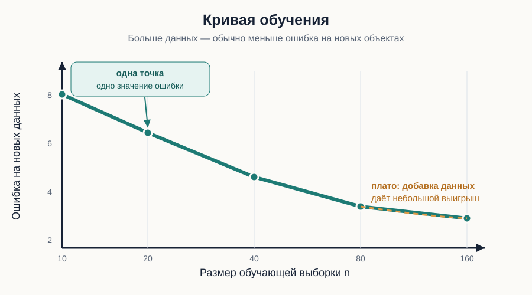
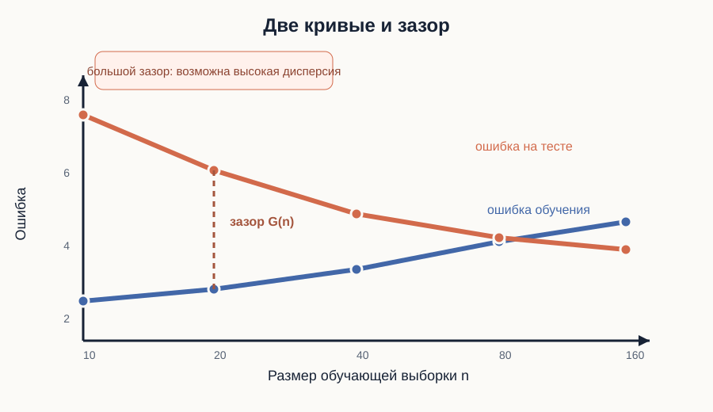
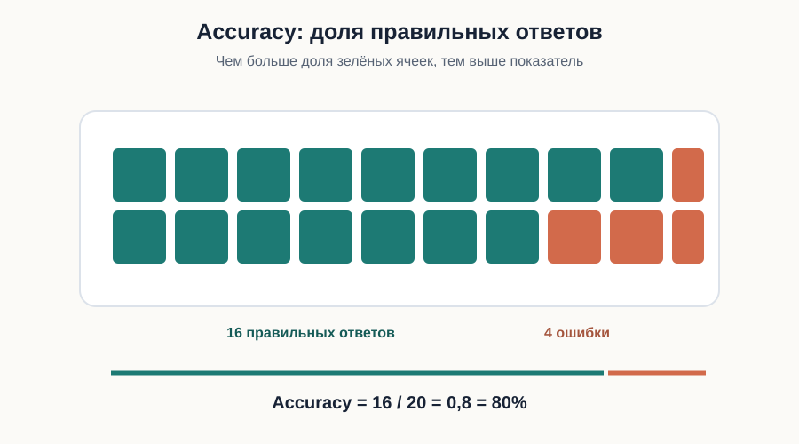
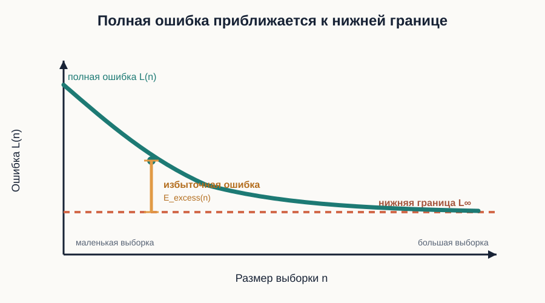
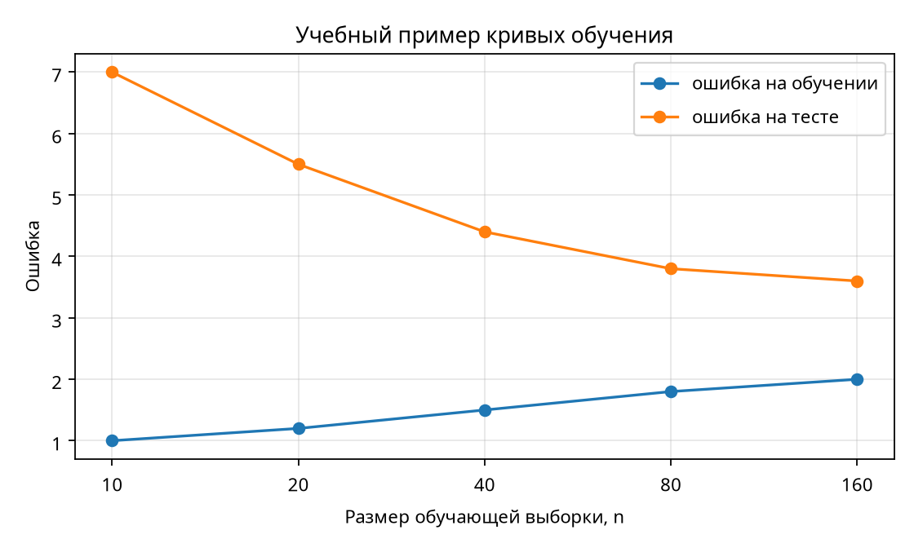

# Теория

## 1. Зачем изучать кривые обучения

При построении модели возникает практический вопрос: **станет ли она работать лучше, если увеличить объём обучающих данных?**

Кривая обучения помогает ответить на этот вопрос. Она показывает, как меняется качество модели при увеличении числа объектов, на которых модель обучается.

Например, мы обучаем одну и ту же модель на выборках размером 20, 50, 100 и 200 объектов. После каждого обучения проверяем качество на новых данных. Полученные значения наносим на график.

- По горизонтальной оси $n$ откладывают размер обучающей выборки.
- По вертикальной оси — качество модели: чаще всего ошибку (loss) или долю правильных ответов (accuracy).

Если по вертикальной оси отложена ошибка, её уменьшение означает улучшение модели. Если отложена доля правильных ответов, улучшению соответствует рост показателя.

**Главная идея:** кривая обучения показывает не качество модели при одном размере выборки, а то, как качество меняется при увеличении обучающих данных.

*На схеме одна точка соответствует одному размеру обучающей выборки. Пологий участок показывает плато: добавление данных даёт небольшой выигрыш.*

## 2. Как строят кривую обучения

Для каждого выбранного размера $n$:

1. Формируют обучающую выборку из $n$ объектов.
2. Обучают на ней модель.
3. Проверяют модель на данных, которые не использовались при обучении.
4. Записывают значение ошибки.
5. Повторяют процедуру несколько раз с другими случайными обучающими выборками.

Повторы нужны потому, что разные случайные выборки могут давать разные результаты. Поэтому для каждого размера $n$ обычно рассчитывают среднюю ошибку:

Для каждого размера выборки усредняем ошибки во всех повторах:

$$
\bar L(n)=\frac{1}{K}\sum_{k=1}^{K}L_k(n).
$$

Краткая запись:

$$
\bar L(n)=\frac{L_1(n)+L_2(n)+\ldots+L_K(n)}{K}.
$$

Здесь:
- $n$ — размер обучающей выборки;
- $K$ — число повторов обучения;
- $L_k(n)$ — ошибка на новых данных в повторе $k$;
- $\bar L(n)$ — средняя ошибка при размере обучающей выборки $n$.

**Важно:** одна точка, полученная после одного обучения, может отражать случайное колебание. Усреднение по нескольким повторам делает оценку надёжнее.

Для корректного сравнения необходимо сохранять одинаковыми способ расчёта метрики, состав тестовых данных и остальные настройки эксперимента. Тестовые данные не должны участвовать в обучении или настройке модели.

## 3. Ошибка на обучающих и новых данных

Обычно на графике показывают две кривые:

- **Training loss** — ошибка на обучающих данных, то есть на тех объектах, которые модель уже видела.
- **Test loss** — ошибка на новых данных, которые не использовались при обучении.

Для ошибки меньшее значение лучше.

Разность между этими ошибками называется зазором (train/test gap):

$$
G(n)=R_{\mathrm{test}}(n)-R_{\mathrm{train}}(n).
$$

Например, ошибка на обучении равна 2, а на тесте — 7. Зазор равен $7-2=5$.

Как интерпретировать две кривые:

- **Обе ошибки высокие и близки.** Модель, вероятно, слишком проста для задачи или недостаточно хорошо обучается. Это возможное недообучение (underfitting).
- **Ошибка на обучении низкая, а на новых данных высокая.** Модель хорошо запомнила обучающие данные, но хуже работает на новых. Это возможное переобучение (overfitting) или высокая чувствительность к составу выборки.
- **С ростом данных ошибка на новых объектах уменьшается, а зазор сокращается.** Дополнительные данные помогают модели лучше обобщать результаты.

Это диагностические признаки, а не строгие доказательства. На качество также влияют признаки, шум, качество данных, выбранная модель и корректность эксперимента.

*Вертикальное расстояние между кривыми показывает зазор между ошибкой на обучении и ошибкой на новых данных.*

## 4. Как измеряют ошибку

Для построения кривой нужно выбрать показатель качества. Он зависит от задачи.

### Регрессия: среднеквадратичная ошибка (MSE)

В регрессии модель предсказывает числовое значение. Среднеквадратичная ошибка показывает, насколько предсказания отличаются от реальных значений:

$$
\mathrm{MSE}=\frac{1}{m}\sum_{i=1}^{m}(y_i-\hat y_i)^2.
$$

Здесь:
- $m$ — число проверяемых объектов;
- $y_i$ — реальное значение;
- $\hat y_i$ — предсказание модели.

Пример: реальные значения — $2, 4, 5$, предсказания — $3, 4, 7$.

Ошибки равны $-1, 0, -2$, их квадраты — $1, 0, 4$.

$$
MSE=\frac{1+0+4}{3}=\frac{5}{3}\approx1,67.
$$

Квадрат ошибки убирает её знак и сильнее учитывает большие отклонения. Чем меньше MSE, тем лучше.

### Классификация: доля правильных ответов (Accuracy)

В классификации модель выбирает класс объекта. Доля правильных ответов показывает, какая часть предсказаний оказалась верной:

Обозначим через $N_{\mathrm{correct}}$ число правильных ответов. Тогда

$$
\mathrm{Accuracy}=\frac{N_{\mathrm{correct}}}{m}.
$$

Например, из 20 объектов модель правильно классифицировала 16:

$$
Accuracy=\frac{16}{20}=0,8=80\%.
$$

*Зелёные ячейки показывают правильные ответы, красные — ошибки классификации.*

Здесь большее значение лучше.

**Не путайте направления:** для Loss лучше уменьшение, для Accuracy — увеличение. При выборе метрики также важно учитывать особенности задачи: например, Accuracy может быть малоинформативна, если классы сильно несбалансированы.

## 5. Почему ошибка не всегда стремится к нулю

Даже если обучающая выборка становится очень большой, ошибка на новых данных не обязательно исчезает. В данных могут присутствовать случайный шум, неполная информация или закономерности, которые выбранная модель не способна описать.

Поэтому удобно разделять ошибку на две части:

$$
L(n)=L_\infty+E_{\mathrm{excess}}(n).
$$

- **Нижняя граница ошибки** — уровень, к которому может приближаться ошибка при увеличении объёма данных для данной задачи и модели.
- **Избыточная ошибка** — дополнительная часть ошибки, связанная, в частности, с ограниченностью обучающей выборки. Она может уменьшаться при добавлении данных.

Рассмотрим простой учебный пример:

$$
L(n)=1+\frac{1}{n}.
$$

Здесь число 1 — нижняя граница, а $1/n$ — избыточная ошибка.

| Размер выборки $n$ | Избыточная ошибка $1/n$ | Полная ошибка $L(n)$ |
|---:|---:|---:|
| 1 | 1,00 | 2,00 |
| 2 | 0,50 | 1,50 |
| 4 | 0,25 | 1,25 |
| 10 | 0,10 | 1,10 |
| 20 | 0,05 | 1,05 |

При увеличении выборки ошибка уменьшается, но не становится меньше 1 в рамках этой модели. Дополнительные данные сокращают избыточную часть, но не устраняют нижнюю границу.

Это иллюстративная математическая модель, а не универсальная формула для любой задачи машинного обучения.

*Полная ошибка приближается к нижней границе, а избыточная ошибка уменьшается при росте $n$.*

## 6. Как понять, достаточно ли данных

Посмотрим на условные значения тестовой ошибки:

| Размер выборки $n$ | 10 | 20 | 40 | 80 | 160 |
|---:|---:|---:|---:|---:|---:|
| Ошибка | 8,0 | 6,0 | 4,8 | 4,2 | 4,1 |

При увеличении выборки с 10 до 40 ошибка заметно снижается. Между 80 и 160 объектами изменение небольшое.

Это может означать, что кривая приближается к плато — участку, где добавление новых данных даёт всё меньший выигрыш.

Но плато не означает, что дополнительные данные бесполезны навсегда. Вывод относится к выбранной модели, метрике, данным и диапазону размеров выборки. Улучшение может потребовать не только новых данных, но и других признаков, изменения модели или настройки её параметров.

Практический вопрос при анализе кривой: **насколько заметно улучшается качество при очередном увеличении объёма данных?**

## 7. Сравнение моделей: важны не только объём данных, но и сама модель

Две модели могут по-разному реагировать на увеличение обучающей выборки.

Например:

$$
L_A(n)=2+\frac{6}{n},\qquad
L_B(n)=3+\frac{2}{n}.
$$

У модели A ниже нижняя граница ошибки, но её избыточная ошибка уменьшается медленнее. У модели B нижняя граница выше, зато при небольшом объёме данных избыточная ошибка меньше.

При $n=2$:

$$
L_A(2)=5,\qquad L_B(2)=4.
$$

Лучше модель B.

При $n=20$:

$$
L_A(20)=2.3,\qquad L_B(20)=3.1.
$$

Лучше модель A.

Следовательно, модель, которая лучше на маленькой выборке, не обязательно останется лучшей при увеличении объёма данных.

**Вывод:** сравнивать модели нужно при одинаковых условиях и на новых данных, а не только по ошибке на обучающей выборке.

## 8. Что кривая обучения может и чего не может показать

Кривая обучения помогает:

- оценить, улучшается ли качество модели при увеличении обучающей выборки;
- увидеть зазор между ошибками на обучении и новых данных;
- обнаружить признаки недообучения или переобучения;
- оценить, приближается ли качество к плато;
- сравнить поведение нескольких моделей при разных объёмах данных.

Но кривая обучения сама по себе не показывает:

- есть ли автокорреляция в остатках;
- сохранилась ли временная структура в ошибках;
- статистически значим ли отдельный параметр;
- верна ли конкретная гипотеза о параметрах модели.

Для этого нужны другие инструменты: анализ остатков, автокорреляционная функция (ACF), тест Вальда и тест отношения правдоподобий.

## 9. Связь со следующими темами курса

Кривая обучения отвечает на вопрос:

**«Как меняется качество модели при увеличении объёма данных?»**

Но даже хорошая средняя ошибка не гарантирует, что модель описывает структуру данных правильно. Поэтому следующий шаг — изучить сами ошибки (остатки):

- посмотреть их график;
- проверить, не образуют ли они систематических последовательностей;
- исследовать автокорреляцию;
- сформулировать и проверить гипотезы о параметрах модели.

Таким образом, кривая обучения оценивает качество обобщения, а анализ остатков и статистические тесты помогают глубже исследовать модель.

## Краткая памятка

| Понятие | Что означает |
|---|---|
| Кривая обучения | Изменение качества модели при увеличении обучающей выборки |
| Training loss | Ошибка на данных, использованных для обучения |
| Test loss | Ошибка на новых данных |
| Train/test gap | Зазор между ошибкой на новых данных и на обучении |
| MSE | Средний квадрат ошибки предсказания |
| Accuracy | Доля правильных классификаций |
| Нижняя граница ошибки | Уровень, к которому может приближаться ошибка при росте объёма данных |
| Избыточная ошибка | Часть ошибки сверх нижней границы |
| Underfitting | Недообучение: модель не улавливает важные закономерности |
| Overfitting | Переобучение: модель хорошо работает на обучающих данных, но хуже — на новых |
| Плато | Участок кривой, где добавление данных даёт небольшой выигрыш |
| Generalization | Способность модели работать на новых данных |
| Residual | Остаток — разность между наблюдаемым и предсказанным значением |
| Autocorrelation | Связь ошибок с их предыдущими значениями |

# Практические задания

## Блок A. Что именно мы усредняем

### Задание 1. Средняя ошибка и разброс результатов

Три пары студентов обучили одну и ту же модель на `n=20` объектах. Они получили следующие ошибки на тестовой выборке:

| Повтор | 1 | 2 | 3 |
|---:|---:|---:|---:|
| Ошибка на тестовой выборке | 4 | 6 | 5 |

1. Найдите среднюю ошибку `L̄(20)`.
2. Найдите выборочную дисперсию и стандартное отклонение результатов.
3. Найдите стандартную ошибку средней оценки при трёх повторах.
4. Что уменьшится примерно в 2 раза, если число независимых повторов увеличить с 3 до 12: стандартное отклонение отдельных результатов или стандартная ошибка среднего?

**Решение.** Сначала складываем три ошибки и делим на число повторов: $\bar L(20)=(4+6+5)/3=5$. Отклонения от среднего равны $-1,1,0$, поэтому $s^2=(1+1+0)/(3-1)=1$ и $s=1$. Стандартная ошибка среднего равна $SE=s/\sqrt{3}=1/\sqrt{3}\approx0,58$. При увеличении числа повторов в 4 раза стандартная ошибка уменьшается в $\sqrt{4}=2$ раза.

**Ответ.** `L̄(20)=5`; `s²=1`, `s=1`, `SE=1/√3≈0.58`. При увеличении числа повторов с 3 до 12 стандартная ошибка среднего уменьшится примерно в 2 раза, а не в 4.
### Задание 2. Построение кривой и проверка зазора ошибок

В таблице приведены ошибки на обучающей и тестовой выборках для двух повторов:

| `n` | Обучение, повтор 1 | Тест, повтор 1 | Обучение, повтор 2 | Тест, повтор 2 |
|---:|---:|---:|---:|---:|
| 10 | 2 | 8 | 3 | 6 |
| 20 | 3 | 6 | 4 | 5 |
| 40 | 4 | 5 | 4 | 4 |

1. Найдите среднюю ошибку на тестовой выборке для каждого `n`.
2. Найдите среднюю ошибку на обучающей выборке для каждого `n`.
3. Найдите средний зазор ошибок для каждого `n`.
4. В каком направлении меняется зазор? Сформулируйте один диагностический вывод.

**Решение.** Для каждого размера выборки усредняем два результата. Например, при $n=10$: тестовая ошибка $(8+6)/2=7$, обучающая $(2+3)/2=2,5$, зазор $7-2,5=4,5$. Аналогично получаем значения для $n=20$ и $n=40$.

**Ответ.** средние тестовые ошибки `7, 5.5, 4.5`; средние обучающие ошибки `2.5, 3.5, 4`; зазоры `4.5, 2, 0.5`. Зазор уменьшается, что согласуется с уменьшением чувствительности к выборке при росте `n`.
### Задание 3. Случайное колебание и среднее качество

Две группы получили результаты:

| `n` | Группа A | Группа B |
|---:|---:|---:|
| 10 | 8 | 6 |
| 20 | 5 | 7 |
| 40 | 4 | 5 |

1. Для каждой группы найдите среднее значение ошибки по трём размерам `n`.
2. Найдите среднее между группами для каждого `n`.
3. Для `n=20` найдите размах результатов между группами.
4. Почему среднее по размерам и среднее по группам отвечают на разные вопросы?

**Решение.** Для группы A: $(8+5+4)/3=17/3\approx5,67$; для группы B: $(6+7+5)/3=6$. При каждом фиксированном $n$ усредняем две группы: $7$, $6$ и $4,5$. При $n=20$ размах равен $7-5=2$.

**Ответ.** средние группы A и B равны `17/3≈5.67` и `6`; средние между группами: `7, 6, 4.5`; размах при `n=20` равен `2`. Среднее по размерам описывает типичное качество каждой группы на выбранных размерах, а среднее по группам при фиксированном `n` оценивает кривую обучения.
### Задание 4. Доля правильных ответов и среднеквадратичная ошибка

Для задачи классификации из 20 объектов указано число правильных ответов. Для задачи регрессии приведены четыре ответа и предсказания:

| Модель классификации | Правильные ответы |
|---|---:|
| A | 14 из 20 |
| B | 16 из 20 |
| C | 15 из 20 |

1. Найдите долю правильных ответов для A, B и C.
2. Для регрессионной модели получены `y=(2,4,5,7)` и `ŷ=(1,5,4,8)`. Найдите MSE.
3. Другая модель дала ошибки `(-1,1,-1,1)`. Сравните её среднеквадратичную ошибку с первой моделью. Что показывает этот пример о влиянии знака ошибки?

**Решение.** Для классификации делим число правильных ответов на 20: $14/20=0,70$, $16/20=0,80$, $15/20=0,75$. В регрессии ошибки первой модели равны $1,-1,1,-1$, их квадраты равны 1, поэтому MSE равна 1. У второй модели квадраты ошибок также равны 1.

**Ответ.** доли правильных ответов: A — `0.70`, B — `0.80`, C — `0.75`. Для первой регрессионной модели ошибки `1,-1,1,-1`, поэтому среднеквадратичная ошибка равна `1`. У второй модели также `1`: среднеквадратичная ошибка не учитывает знак ошибки, потому что ошибки возводятся в квадрат.
## Блок B. Расчёты по точной формуле

### Задание 5. Восстановление кривой по формуле

Для модели известна формула `L(n)=1+1/n`. Заполните таблицу и укажите отдельно нижнюю границу и избыточную ошибку:

| `n` | 1 | 2 | 4 | 10 | 20 |
|---:|---:|---:|---:|---:|---:|
| `L(n)` |  |  |  |  |  |
| `L(n)-1` |  |  |  |  |  |

1. Постройте примерный график.
2. При каком минимальном `n` избыточная ошибка станет не больше `0.02`?

**Решение.** Подставляем каждое значение $n$ в $L(n)=1+1/n$, а избыточную ошибку получаем вычитанием нижней границы 1. Условие $1/n\le0,02$ равносильно $n\ge50$.

**Ответ.** `L(n)=2,1.5,1,25,1.1,1,05`; избыточная ошибка `1,0.5,0,25,0.1,0,05`; нижняя граница `1`. Нужно `1/n≤0.02`, то есть `n≥50`.
### Задание 6. Полная и избыточная ошибка

Для `L(n)=1+1/n` найдите и сравните:

1. нижнюю границу при `n→∞`;
2. полную и избыточную ошибки при `n=4`;
3. полную и избыточную ошибки при `n=20`;
4. какая из двух величин уменьшилась в 5 раз, а какая — нет?

**Решение.** При $n\to\infty$ член $1/n$ стремится к нулю, поэтому нижняя граница равна 1. При $n=4$: $L=1+1/4=1,25$, избыточная ошибка $0,25$. При $n=20$: $L=1+1/20=1,05$, избыточная ошибка $0,05$.

**Ответ.** нижняя граница `1`; при `n=4`: полная `1,25`, избыточная `0,25`; при `n=20`: полная `1,05`, избыточная `0,05`. В 5 раз уменьшилась избыточная ошибка; полная уменьшилась с `1,25` до `1,05`, то есть в `1.19` раза.
### Задание 7. Сравнение двух моделей по кривым

Две модели имеют кривые

$$
L_A(n)=2+\frac{6}{n},
\qquad
L_B(n)=3+\frac{2}{n}.
$$

1. Найдите `L_A(2)`, `L_B(2)`, `L_A(20)` и `L_B(20)`.
2. Какая модель лучше при `n=2`, а какая — при `n=20`?
3. Найдите размер `n`, при котором кривые пересекаются.
4. Объясните результат через компромисс между нижней границей и скоростью уменьшения избыточной ошибки.

**Решение.** Вычисляем значения обеих кривых при $n=2$ и $n=20$. Точку пересечения находим из $2+6/n=3+2/n$: $4/n=1$, поэтому $n=4$.

**Ответ.** `L_A(2)=5`, `L_B(2)=4`; `L_A(20)=2.3`, `L_B(20)=3.1`. При `n=2` лучше B, при `n=20` лучше A. Пересечение: `2+6/n=3+2/n`, откуда `n=4`. У B меньше избыточная ошибка при малых `n`, у A ниже нижняя граница.
### Задание 8. Сложность, объём данных и выбор модели

Для учебной оценки используем

Обозначим добавку к ошибке через $E_{\mathrm{add}}(n)$. Тогда

$$
E_{\mathrm{add}}(n)\approx\sqrt{C/n}.
$$

Считайте, что ожидаемая ошибка имеет вид

$$
L(n)=L_\infty+\sqrt{C/n}.
$$

То есть **полная ошибка** равна сумме нижней границы и избыточной ошибки:

$$
L(n)=L_\infty+\sqrt{C/n}.
$$

Например, для модели A при `n=25`: нижняя граница равна `4`, избыточная ошибка равна `√(1/25)=0.2`, поэтому полная ошибка равна `4+0.2=4,2`.

Для двух моделей известны:

- модель A: `L∞=4`, `C=1`;
- модель B: `L∞=2`, `C=9`.

1. Найдите полную ошибку обеих моделей при `n=25` и `n=100`.
2. Какая модель лучше при каждом размере выборки?
3. Найдите, при каком `n` модели имеют одинаковую ошибку.
4. Сколько объектов нужно модели B, чтобы её добавка стала равна добавке модели A при `n=100`?
5. Сделайте вывод: всегда ли модель с меньшей сложностью лучше?

**Решение.** Используем $L(n)=L_\infty+\sqrt{C/n}$. Для A при $n=25$: $4+\sqrt{1/25}=4,2$; для B: $2+\sqrt{9/25}=2,6$. При $n=100$ получаем $4,1$ и $2,3$. Пересечение: $4+1/\sqrt n=2+3/\sqrt n$, откуда $n=1$. Чтобы добавка B была равна 0,1, решаем $3/\sqrt n=0,1$ и получаем $n=900$.

**Ответ.** при `n=25`: `L_A=4,2`, `L_B=2.6`; при `n=100`: `L_A=4,1`, `L_B=2.3`, поэтому B лучше в обоих случаях. Пересечение решается из `4+1/√n=2+3/√n`, откуда `√n=1`, то есть `n=1`; при больших `n` преимущество более сложной модели связано с меньшей нижней границей. Чтобы добавка B была равна добавке A при `n=100`, нужно `3/√n=0.1`, поэтому `n=900`. Меньшая сложность не всегда лучше: важны и ошибка аппроксимации, и объём данных.
## Блок C. Диагностика по таблицам и графикам

### Задание 9. Найдите зазор между ошибками

| `n` | Ошибка на обучении | Ошибка на тесте |
|---:|---:|---:|
| 10 | 0.5 | 8,0 |
| 20 | 0.8 | 6,0 |
| 40 | 1.2 | 4.5 |
| 80 | 1.7 | 3.8 |

1. Найдите зазор ошибок для каждого `n` по формуле `тестовая ошибка − обучающая ошибка`.
2. Как меняется зазор?
3. Какой диагностический вывод можно сделать?

**Решение.** Для каждого размера вычитаем ошибку обучения из ошибки теста: $8-0,5=7,5$, $6-0,8=5,2$, $4,5-1,2=3,3$, $3,8-1,7=2,1$. Последовательность убывает.

**Ответ.** зазоры `7.5`, `5.2`, `3.3`, `2.1`. Зазор уменьшается; модель становится устойчивее по мере роста выборки, хотя при малом `n` наблюдается высокий разброс.
### Задание 10. Недообучение или переобучение

Сравниваются две модели:

| Модель | Ошибка на обучении | Ошибка на тесте |
|---|---:|---:|
| Простая | 4.0 | 4.5 |
| Гибкая | 0.4 | 7.0 |

Для каждой модели выберите наиболее вероятное описание: `A` — недообучение; `B` — высокая дисперсия; `C` — модель явно лучше.

**Решение.** У простой модели обе ошибки близки и достаточно велики: это признак возможного недообучения. У гибкой модели ошибка обучения мала, а тестовая ошибка велика: это согласуется с высокой дисперсией или переобучением. Это диагностические признаки, а не строгое доказательство.

**Ответ.** простая модель — скорее `A`, гибкая — скорее `B`. По одной таблице нельзя утверждать окончательную причину.
### Задание 11. Достаточно ли данных?

Средняя ошибка на тестовой выборке:

| `n` | 10 | 20 | 40 | 80 | 160 |
|---:|---:|---:|---:|---:|---:|
| Loss | 8,0 | 6,0 | 4,8 | 4,2 | 4,1 |

1. На каком участке добавление данных приносит наибольшую пользу?
2. На каком участке кривая почти стабилизировалась?
3. Можно ли сказать, что дополнительные данные никогда не помогут?

**Решение.** Сравниваем последовательные изменения тестовой ошибки: от 10 к 20 снижение 2, от 20 к 40 снижение 1,2, затем 0,6 и 0,1. Наибольшая польза наблюдается на участке 10–40, а после 80 кривая близка к плато. По конечному участку нельзя утверждать, что новые данные никогда не помогут.

**Ответ.** на участке `10–40`; примерно после `80`; нет, можно говорить только о слабой пользе в наблюдаемом диапазоне и для данной модели.
### Задание 12. Выберите правдоподобный рисунок

Рассмотрите три пары словесных графиков:

- **График A:** ошибки на обучении и тесте обе высокие и почти горизонтальные.
- **График B:** ошибка на обучении почти нулевая, ошибка на тесте высокая, но постепенно снижается.
- **График C:** ошибка на обучении растёт, ошибка на тесте снижается, и обе кривые сближаются.

Для каждого графика укажите наиболее подходящую интерпретацию:

1. высокая дисперсия при малом `n`;
2. возможное недообучение;
3. модель получает пользу от добавления данных.

**Решение.** График A соответствует возможному недообучению: обе ошибки высокие. График B соответствует высокой дисперсии при малом $n$: ошибка обучения почти нулевая, а тестовая выше. График C показывает пользу дополнительных данных: тестовая ошибка снижается, а кривые сближаются.

**Ответ.** A–2, B–1, C–3. Обсудите, почему это не строгая классификация.
### Задание 13. Анализ графика кривых обучения

По графику ответьте на вопросы:

1. Примерно чему равны ошибки на обучении и тесте при `n=40`?
2. Найдите зазор ошибок при `n=20` и `n=160`.
3. На каком участке добавление данных даёт наибольшее уменьшение тестовой ошибки?
4. Есть ли на графике признаки переобучения? Обоснуйте ответ двумя наблюдениями.
5. Что можно предположить о пользе добавления ещё 160 объектов: она будет большой или небольшой? Почему это только предположение?

**Решение.** Считываем с графика значения при $n=40$ и вычитаем ошибку обучения из тестовой при $n=20$ и $n=160$. Затем сравниваем падение тестовой кривой на разных участках. Большой начальный зазор сам по себе не доказывает переобучение, потому что тестовая ошибка продолжает снижаться при добавлении данных.

**Ответ.** при `n=40` ошибки примерно равны `1.5` и `4.4`; зазоры при `n=20` и `n=160` равны `4.3` и `1.6`; наибольшее уменьшение тестовой ошибки видно на участке `10–40`; в начале есть большой зазор, но тестовая ошибка уменьшается при добавлении данных, поэтому это скорее высокая чувствительность к малой выборке, а не доказанное переобучение; после `n=80` улучшение небольшое, но вывод ограничен показанным диапазоном.
## Блок D. Разброс и неопределённость

### Задание 14. Стандартное отклонение и стандартная ошибка

Для `n=20` получены ошибки на тестовой выборке:

$$
4,\ 6,\ 5,\ 7.
$$

Используйте среднее `5.5` и найдите:

1. отклонения от среднего;
2. сумму квадратов отклонений;
3. дисперсию по формуле `s²=Σ(x_i−x̄)²/(K−1)`;
4. `s` и стандартную ошибку среднего `SE=s/√K`.

**Решение.** При среднем 5,5 отклонения равны $-1,5$, $0,5$, $-0,5$, $1,5$. Сумма квадратов равна $2,25+0,25+0,25+2,25=5$. Поэтому $s^2=5/3\approx1,67$, $s\approx1,29$, а $SE=s/\sqrt4\approx0,65$.

**Ответ.** отклонения `−1.5, 0.5, −0.5, 1.5`; сумма квадратов `5`; `s²=5/3≈1.67`; `s≈1.29`; `SE≈0.65`.
### Задание 15. Узкий интервал — не всегда стабильная модель

Для двух размеров выборки получены результаты:

| `n` | Средняя ошибка на тесте | Стандартное отклонение между повторами | Число повторов `K` |
|---:|---:|---:|---:|
| 20 | 5.0 | 2.0 | 4 |
| 80 | 4,2 | 1.0 | 4 |

1. Найдите стандартную ошибку среднего для обоих `n`.
2. Где отдельное обучение более стабильно?
3. Где средняя ошибка на тесте оценена точнее?

**Решение.** Используем $SE=s/\sqrt K$. Для $n=20$: $SE=2/\sqrt4=1$. Для $n=80$: $SE=1/\sqrt4=0,5$. Меньшее стандартное отклонение означает большую стабильность отдельных результатов, а меньшее SE — более точную оценку средней ошибки.

**Ответ.** `SE(20)=1`, `SE(80)=0.5`; при `n=80` отдельные результаты стабильнее и среднее оценено точнее.
## Блок E. Связь со следующими темами

### Задание 16. Кривая обучения, остатки и статистические тесты

Распределите утверждения по трём инструментам: **кривая обучения**, **анализ остатков и автокорреляционной функции**, **тест Вальда или тест отношения правдоподобий**.

1. Проверить, уменьшается ли средняя ошибка при увеличении `n`.
2. Проверить, образуют ли ошибки временные серии одного знака.
3. Проверить гипотезу `H_0:β=0`.
4. Посмотреть, есть ли пик автокорреляции на лаге 1.
5. Сравнить модель с ограничением и без ограничения по log-likelihood.
6. Понять, приносит ли сбор дополнительных данных пользу для данной модели.

**Решение.** Сопоставляем вопрос и инструмент. Изменение средней ошибки при росте $n$ проверяет кривая обучения. Последовательности ошибок и пик на лаге 1 изучают остатки и ACF. Гипотезу $H_0:\beta=0$ проверяют тестом Вальда, а сравнение ограниченной и неограниченной моделей по log-likelihood — тестом отношения правдоподобий.

**Ответ.**

- кривая обучения: `1, 6`;
- остатки и автокорреляция: `2, 4`;
- тест Вальда или тест отношения правдоподобий: `3, 5`.

Главный вывод: эти методы отвечают на разные вопросы и не заменяют друг друга.
# Обсуждение после решения

Обсудите в группе четыре вопроса:

1. Почему одна ошибка на тестовой выборке при `n=20` не является точкой теоретической кривой обучения?
2. Почему добавление данных может уменьшить избыточную ошибку, но не устранить шумовую нижнюю границу?
3. Почему малая ошибка на обучающей выборке сама по себе ничего не говорит о качестве на новых данных?
4. Какой вопрос мы зададим на следующем семинаре после того, как оценили общую ошибку?

Ожидаемый ответ на последний вопрос:

> Нужно выяснить, **какая структура осталась в ошибках**. Для этого будем изучать остатки, их графики и автокорреляцию. Затем будем формулировать конкретные гипотезы о параметрах и проверять их с помощью теста Вальда и теста отношения правдоподобий.

## Словарик терминов

| English | Русский термин |
|---|---|
| learning curve | кривая обучения |
| training set | обучающая выборка |
| test set | тестовая выборка |
| training loss | ошибка на обучающей выборке |
| test loss | ошибка на тестовой выборке |
| loss function | функция потерь |
| risk | риск, ожидаемая ошибка |
| empirical risk | эмпирический риск |
| mean squared error, MSE | среднеквадратичная ошибка |
| accuracy | доля правильных ответов |
| excess error | избыточная ошибка |
| error floor | нижняя граница ошибки |
| train/test gap | зазор между ошибками на обучении и тесте |
| bias | смещение |
| variance | разброс, дисперсия предсказаний |
| approximation error | ошибка аппроксимации |
| estimation error | оценочная ошибка |
| underfitting | недообучение |
| overfitting | переобучение |
| generalization | обобщение |
| generalization error | ошибка обобщения |
| standard deviation | стандартное отклонение |
| standard error | стандартная ошибка |
| residual | остаток |
| autocorrelation | автокорреляция |
| autocorrelation function, ACF | автокорреляционная функция |
| Wald test | тест Вальда |
| likelihood-ratio test | тест отношения правдоподобий |
| score | показатель качества; в статистике также функция счёта |
