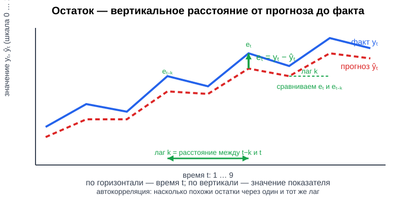
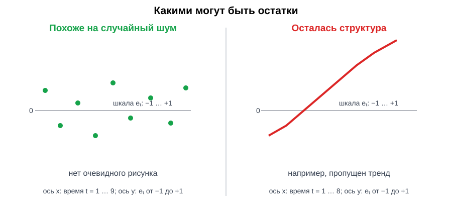
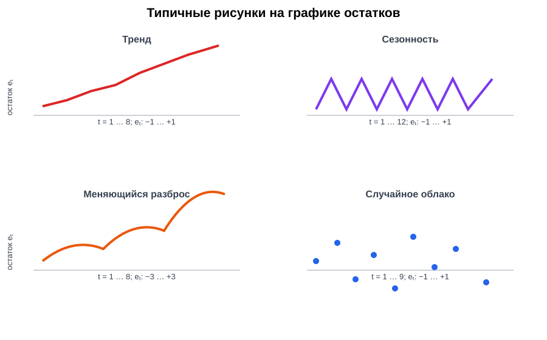
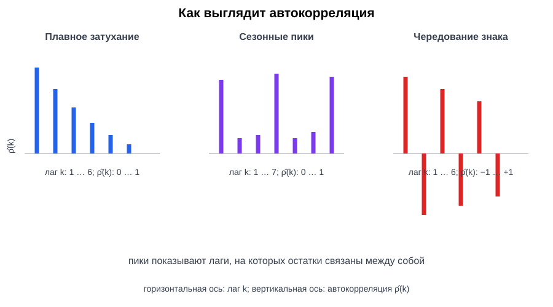
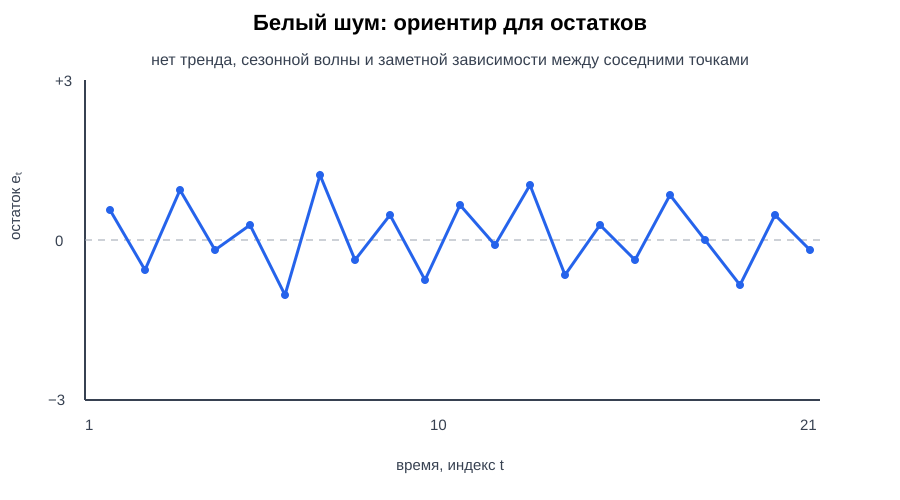
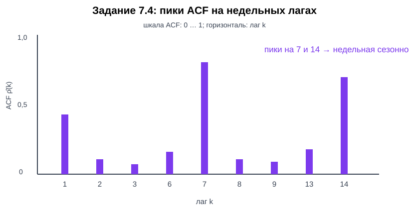
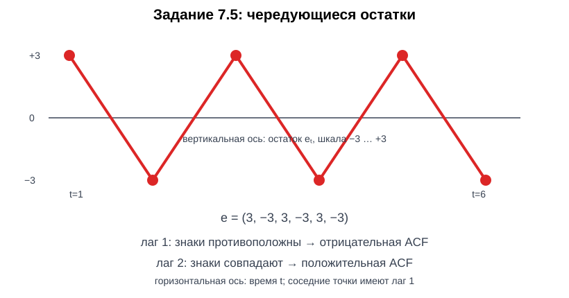

# Оценка остатков во временных рядах: структура и автокорреляция

> Материал по семинару 3 темы 4 «Математическая теория обобщения и диагностики моделей». Семинар идёт после материала о кривых обучения и подготавливает к диагностике временных рядов.

---

## 1. Зачем анализировать остатки

В предыдущем семинаре мы сравнивали ошибку модели на обучении и на новых данных. Для временного ряда этого недостаточно: наблюдения идут во времени и могут зависеть друг от друга.

Пусть $y_t$ — фактическое значение показателя в момент времени $t$, а $\hat y_t$ — прогноз модели. **Остаток** — разность между фактом и прогнозом:

$$
e_t = y_t - \hat y_t.
$$

Здесь:

- $t$ — индекс времени: день, неделя, месяц или другой шаг;
- $y_t$ — наблюдаемое значение показателя;
- $\hat y_t$ — значение, предсказанное моделью;
- $e_t$ — остаток в момент $t$.

Примеры:

- для доходности акции $y_t$ — фактическая доходность дня, $\hat y_t$ — прогноз доходности;
- для числа заявок на кредит $y_t$ — фактическое число заявок за день, $\hat y_t$ — прогноз;
- для уровня просрочки $y_t$ — фактическая доля дефолтов, $\hat y_t$ — прогноз модели.

*Рисунок 1. Остаток — вертикальное расстояние между фактическим значением и прогнозом.*

Остаток — это не то же самое, что «ошибка модели вообще». Это конкретная ошибка на конкретном временном шаге. Набор остатков $e_1,e_2,\ldots,e_T$ позволяет проверить, что именно модель не объяснила.

---

## 2. Какими должны быть хорошие остатки

После адекватной модели остатки должны напоминать **неструктурированный шум**:

1. среднее значение близко к нулю;
2. нет заметного тренда во времени;
3. нет повторяющейся сезонной волны;
4. разброс примерно стабилен;
5. соседние остатки не имеют систематической зависимости.

Это не означает, что каждый остаток должен быть малым. Случайный шум может давать отдельные большие ошибки. Важно, чтобы ошибки не образовывали устойчивый рисунок, который можно было бы предсказать.

Если остатки долго положительны, модель систематически занижает прогноз. Если затем долго отрицательны, она систематически завышает прогноз. Такой рисунок указывает, что в модели может не хватать тренда, сезонности или других признаков.

*Рисунок 2. Случайное облако — ориентир; выраженный рисунок требует диагностики.*

### Остаток и ошибка прогноза

В задачах с квадратичной потерей средняя ошибка оценивается через остатки:

$$
\operatorname{MSE} = \frac{1}{T}\sum_{t=1}^{T} e_t^2.
$$

Средняя абсолютная ошибка имеет вид:

$$
\operatorname{MAE} = \frac{1}{T}\sum_{t=1}^{T} |e_t|.
$$

MSE сильнее реагирует на большие промахи, а MAE измеряется в тех же единицах, что и исходный показатель.

---

## 3. Временная структура остатков

### 3.1. График остатков

Первый шаг диагностики — построить точки $(t,e_t)$ в порядке времени.

На графике ищем:

| Наблюдаемый рисунок | Возможная причина |
|---|---|
| Длинные серии остатков одного знака | пропущен тренд или модель запаздывает |
| Волна с повторяющимся периодом | не учтена сезонность |
| Разброс растёт вместе с уровнем ряда | меняется дисперсия, возможна трансформация |
| Один или несколько огромных остатков | выброс, структурный сдвиг или ошибка данных |
| Остатки выглядят как случайное облако | явной временной структуры не видно |

График не доказывает отсутствие зависимости. Он помогает сформулировать гипотезу, которую затем проверяют численно.

*Рисунок 3. Тренд, сезонность, меняющийся разброс и случайное облако.*

### 3.2. Лаг и соседние наблюдения

**Лаг $k$** — расстояние между двумя моментами времени. При лаге 1 сравниваются соседние остатки $e_t$ и $e_{t-1}$, при лаге 7 — остатки с интервалом в семь шагов.

Если дневные данные имеют недельную сезонность, зависимость может быть особенно заметна на лаге 7. Для месячных данных сезонный лаг часто равен 12.

---

## 4. Автокорреляция остатков

**Автокорреляция** измеряет линейную связь ряда с самим собой, сдвинутым во времени.

**Стационарный ряд** — это ряд, основные статистические свойства которого не меняются при сдвиге во времени. В слабом смысле это означает: среднее значение постоянно, дисперсия постоянна, а ковариация между двумя наблюдениями зависит только от расстояния между ними, то есть от лага $k$, а не от конкретного момента $t$. Стационарность — это модельное предположение или приближение; один график не доказывает её.

Для теоретического стационарного ряда остатков автокорреляция на лаге $k$ определяется так:

$$
\rho(k) = \frac{\operatorname{Cov}(e_t,e_{t-k})}{\operatorname{Var}(e_t)}.
$$

Здесь:

- $\rho(k)$ — автокорреляция на лаге $k$;
- $\operatorname{Cov}$ — ковариация двух величин;
- $\operatorname{Var}$ — дисперсия остатков;
- $e_{t-k}$ — остаток, отстоящий от $e_t$ на $k$ шагов.

Для набора из $T$ наблюдений используют выборочную автокорреляцию. Обозначим средний остаток через

$$
\bar e = \frac{1}{T}\sum_{t=1}^{T} e_t.
$$

Тогда оценка автокорреляции на лаге $k$ равна:

$$
\widehat{\rho}(k) =
\frac{\sum_{t=k+1}^{T}(e_t-\bar e)(e_{t-k}-\bar e)}
{\sum_{t=1}^{T}(e_t-\bar e)^2}.
$$

Числитель сравнивает остатки через $k$ шагов, а знаменатель нормирует результат на общий разброс.

Интерпретация:

- $\widehat{\rho}(k)>0$ — остатки на расстоянии $k$ чаще имеют одинаковый знак;
- $\widehat{\rho}(k)<0$ — после положительного отклонения чаще следует отрицательное, и наоборот;
- значение около нуля — линейной связи на этом лаге не видно.

Автокорреляция не доказывает причинность. Она показывает зависимость во времени, но не объясняет, почему она возникла.

---

## 5. Как читать график автокорреляции

График ACF показывает значения $\widehat{\rho}(k)$ для нескольких лагов $k$.

Типичные рисунки:

| Вид ACF | Возможная интерпретация |
|---|---|
| Большое положительное значение на лаге 1 и плавное затухание | инерция или медленное изменение ряда |
| Пики на лагах 7, 14, 21 | недельная сезонность в дневных данных |
| Чередование положительных и отрицательных значений | колебательный или переоценивающий прогноз |
| Почти все значения около нуля | остатки похожи на белый шум |
| Медленное затухание с большим первым пиком | тренд или нестационарность могли остаться в остатках |

Небольшие случайные пики допустимы. Решение принимают не по одному столбцу, а по общей картине и предметному контексту.

*Рисунок 4. Затухание, сезонные пики и чередование знака имеют разные диагностические смыслы.*

### Белый шум как ориентир

Последовательность $\{e_t\}$ называют белым шумом в простейшем случае, если:

- $\mathbb{E}(e_t)=0$;
- $\operatorname{Var}(e_t)=\sigma^2$ не зависит от $t$;
- $\operatorname{Cov}(e_t,e_{t-k})=0$ для всех $k\neq0$.

Белый шум не обязан иметь нормальное распределение. Для диагностики временной зависимости важнее отсутствие автокорреляции, чем форма распределения.

*Рисунок 5. Белый шум колеблется вокруг нулевого уровня без заметного тренда и повторяющегося рисунка.*

---

## 6. Связь с кривыми обучения

Кривая обучения отвечает на вопрос: **как меняется средняя ошибка при увеличении обучающей выборки?**

Анализ остатков отвечает на другой вопрос: **какая структура осталась в ошибках после обучения?**

Модель может иметь хорошую среднюю тестовую ошибку, но плохие остатки. Например, положительные и отрицательные ошибки могут взаимно компенсироваться в MSE, хотя их последовательность содержит недельную сезонность.

Для временных данных важно не перемешивать наблюдения без причины. Случайное перемешивание может разрушить временную структуру и привести к слишком оптимистичной оценке качества. Разбиение на обучение и тест должно уважать порядок времени.

Если автокорреляция остатков заметна, возможны следующие действия:

1. добавить лаги исходного показателя или признаков;
2. добавить календарные признаки и сезонность;
3. включить тренд или изменить спецификацию модели;
4. использовать модель, которая учитывает зависимость во времени;
5. проверить, не возникла ли утечка информации из будущего.

Это не автоматический список исправлений: сначала нужно понять источник зависимости.

---

## 7. Практические задания

### 7.1. Остатки прогноза доходности

Для пяти торговых дней фактические доходности равны $y=(2, -1, 3, 0, 4)$, а прогнозы модели — $\hat y=(1, 0, 2, 1, 3)$, в условных базисных пунктах.

1. Найдите остатки $e_t$.
2. Найдите MSE и MAE.
3. Есть ли у модели общий сдвиг в сторону занижения или завышения прогноза?

**Решение.** Вычитаем прогноз из факта по каждому дню: получаем остатки `(1, -1, 1, -1, 1)`. Квадраты и абсолютные значения всех остатков равны 1, поэтому MSE и MAE равны 1. Средний остаток равен 0.

**Ответ:** модель не показывает общего сдвига вверх или вниз по этим пяти дням. Это не означает отсутствия автокорреляции.

### 7.2. Средний остаток и смещение

Для прогноза числа заявок на кредит получены остатки:

$$
(8,\ 5,\ -2,\ -7,\ -4).
$$

Найдите средний остаток. Как интерпретировать его знак? Можно ли по одному среднему остатку заключить, что автокорреляции нет?

**Решение.** Складываем остатки и делим на их число: `(8 + 5 - 2 - 7 - 4) / 5 = 0`.

**Ответ:** средний остаток равен 0; общего смещения не видно. По одному среднему нельзя сделать вывод об автокорреляции, потому что порядок остатков не используется.

### 7.3. Автокорреляция на первом лаге

Для остатков

$$
e=(2,\ 1,\ 0,\ -1,\ -2)
$$

средний остаток равен нулю. Вычислите выборочную автокорреляцию на лаге 1 по формуле из раздела 4. Объясните знак результата.

**Решение.** При среднем остатке 0 числитель для лага 1 равен `2·1 + 1·0 + 0·(-1) + (-1)·(-2) = 4`, а знаменатель равен `2² + 1² + 0² + (-1)² + (-2)² = 10`. Поэтому выборочная автокорреляция равна `4/10 = 0,4`.

**Ответ:** автокорреляция на первом лаге равна `0,4` и положительна.

### 7.4. Недельная сезонность

Для дневного прогноза банковских заявок график ACF имеет крупные положительные пики на лагах 7, 14 и 21, а на лаге 1 значение умеренное.

1. Какую гипотезу о данных это поддерживает?
2. Какой признак можно добавить в модель?
3. Почему одного уменьшения MSE может быть недостаточно для обнаружения этой проблемы?

*Рисунок 6. Визуальная подсказка к заданию 7.4.*

**Решение.** Пики через 7 дней и через 14 дней повторяются с недельным периодом. В модель можно добавить день недели, календарь праздников или значение показателя неделю назад. MSE усредняет величину ошибок и может не показать, что ошибки повторяются по календарному циклу.

**Ответ:** наиболее вероятна недельная сезонность; её нужно проверить по календарным признакам и ACF.

### 7.5. Остатки с чередующимися знаками

Остатки модели для цены актива имеют вид:

$$
(3,\ -3,\ 3,\ -3,\ 3,\ -3).
$$

1. Какой знак автокорреляции на лаге 1 ожидается?
2. Как будет выглядеть последовательность на лаге 2?
3. Какой тип поведения модели может давать такой рисунок?

*Рисунок 7. Визуальная подсказка к заданию 7.5.*

**Решение.** На лаге 1 соседние остатки имеют противоположные знаки, поэтому произведения отрицательны и автокорреляция отрицательна. На лаге 2 знаки совпадают, поэтому автокорреляция положительна.

**Ответ:** ожидается отрицательная ACF на лаге 1 и положительная на лаге 2. Рисунок похож на колебательную или переоценивающую модель.

### 7.6. Диагностика по графику

Для трёх моделей получены описания остатков:

- модель A: остатки долго положительны, затем долго отрицательны;
- модель B: заметные пики ACF на лагах 7 и 14;
- модель C: остатки похожи на случайное облако, а ACF почти всюду близка к нулю.

Соотнесите модели с наиболее вероятной проблемой: пропущенный тренд, недельная сезонность, отсутствие очевидной временной структуры.

**Решение.** Длинные серии одного знака у модели A соответствуют пропущенному тренду. Пики на 7 и 14 у модели B соответствуют недельной сезонности. У модели C явной структуры не видно.

**Ответ:** A — тренд, B — недельная сезонность, C — отсутствие очевидной временной структуры.

### 7.7. Временное разбиение

Банк хочет предсказывать просрочку в январе по данным до конца декабря. Исследователь случайно перемешал все месяцы и разделил их на обучение и тест.

1. Почему такое разбиение может дать слишком оптимистичную оценку?
2. Как построить более честное разбиение?
3. Почему автокорреляция остатков важна именно при прогнозировании будущего?

**Решение.** При случайном перемешивании в обучение могут попасть будущие наблюдения, а близкие зависимые точки окажутся по разные стороны разбиения. Нужно обучаться на раннем отрезке и тестироваться на последующем; для настройки использовать последовательные временные окна.

**Ответ:** случайное разбиение может быть слишком оптимистичным. Временное разбиение лучше сохраняет реальную задачу прогноза будущего.

### 7.8. Связь с кривой обучения

Для двух моделей получены одинаковые значения MSE на тесте: `0,20`. У модели A остатки имеют ACF около нуля, у модели B автокорреляция на лаге 7 равна `0,65`.

Какую модель следует предпочесть для ежедневного прогнозирования спроса и какие дополнительные проверки нужны?

---

**Решение.** Средняя ошибка одинакова, поэтому по одному MSE модели не различаются. У модели A ACF около нуля, а у модели B зависимость на лаге 7 равна `0,65`, что похоже на неучтённую недельную структуру.

**Ответ:** исходно следует предпочесть модель A. Для модели B нужно проверить календарные признаки, лаги, стабильность на будущем временном отрезке, изменение дисперсии и утечку информации.

### 7.9. Скользящее среднее остатков

Для остатков прогноза недельного спроса вычислено скользящее среднее по окну из трёх дней:

| День $t$ | 1 | 2 | 3 | 4 | 5 | 6 |
|---:|---:|---:|---:|---:|---:|---:|
| Остаток $e_t$ | 2 | 4 | 5 | -1 | -3 | -4 |

1. Найдите средние по окнам $(1,2,3)$, $(2,3,4)$, $(3,4,5)$ и $(4,5,6)$.
2. В какой момент скользящее среднее меняет знак?
3. Какой возможный сдвиг в модели может означать такая смена?

**Решение.** Средние по окнам равны примерно `3,67`, `2,67`, `0,33` и `-2,67`. Знак меняется между третьим и четвёртым окном.

**Ответ:** смена знака может указывать на смену режима, структурный сдвиг или запаздывающий прогноз.

### 7.10. Изменение разброса финансового ряда

В первой половине квартала абсолютные остатки модели равны примерно $1,2,1,2$, а во второй — $5,7,6,8$.

1. Сравните средний абсолютный остаток в двух половинах.
2. Что это говорит о стабильности дисперсии?
3. Назовите один способ диагностики или исправления проблемы.

**Решение.** Средний абсолютный остаток в первой половине равен `1,5`, во второй — `6,5`. Разброс ошибок увеличился более чем в четыре раза.

**Ответ:** стабильность дисперсии сомнительна. Нужно проверить график абсолютных остатков и рассмотреть преобразование или модель с меняющейся дисперсией.

### 7.11. Поиск сезонного лага

Для прогноза числа заявок получены оценки ACF:

| Лаг $k$ | 1 | 2 | 3 | 4 | 5 | 6 | 7 | 14 |
|---:|---:|---:|---:|---:|---:|---:|---:|---:|
| $\widehat{\rho}(k)$ | 0,18 | 0,05 | -0,02 | 0,01 | 0,04 | 0,12 | 0,61 | 0,48 |

1. На каком лаге зависимость наиболее заметна?
2. Какая сезонность возможна?
3. Почему пик на лаге 14 поддерживает ту же гипотезу, а не обязательно указывает на отдельную двухнедельную причину?

**Решение.** Наибольшее значение ACF равно `0,61` на лаге 7. Пик на лаге 14 поддерживает тот же недельный цикл: 14 дней содержат два недельных периода.

**Ответ:** наиболее вероятна недельная сезонность.

### 7.12. Итоговый диагностический отчёт

Для модели прогнозирования просрочки получены результаты: MSE на временном тесте равна `0,18`, средний остаток равен `0,01`, ACF на лаге 1 равна `0,08`, а ACF на лаге 12 равна `0,52`.

Составьте короткий отчёт из трёх частей:

1. что уже выглядит приемлемо;
2. какая проблема требует проверки;
3. какое следующее действие вы предложите команде.

**Решение.** MSE и средний остаток выглядят приемлемо, а ACF на лаге 1 невелика. Но ACF на лаге 12 равна `0,52`, поэтому в остатках может оставаться сезонность с периодом 12 шагов.

**Ответ:** проверить график остатков и сезонность на лаге 12, добавить календарные или сезонные признаки и повторить оценку на последующем временном отрезке.

## 8. Памятка

1. Остаток — это $e_t=y_t-\hat y_t$.
2. Положительный остаток означает, что модель занизила прогноз; отрицательный — что завысила.
3. График остатков ищет тренд, сезонность, изменение разброса и выбросы.
4. ACF проверяет связь остатков с самими собой на разных лагах.
5. Пик на лаге 7 в дневных данных может указывать на недельную сезонность.
6. Хорошая средняя ошибка не гарантирует отсутствия временной структуры.
7. Для будущего прогноза разбиение данных должно сохранять порядок времени.
8. Остатки, похожие на белый шум, — ориентир, а не автоматическое доказательство правильности модели.

---

## 9. Словарь терминов

| Термин | Определение | Роль в семинаре |
|---|---|---|
| Временной ряд | Наблюдения, упорядоченные по времени | Объект диагностики |
| Остаток | Разность $e_t=y_t-\hat y_t$ между фактом и прогнозом | Основной объект анализа |
| Лаг | Расстояние между двумя моментами времени | Индекс временной зависимости |
| Автокорреляция | Связь ряда с его сдвинутой копией | Показывает зависимость остатков |
| Стационарный ряд | Ряд, у которого среднее и дисперсия постоянны, а зависимость между значениями определяется только лагом, а не календарным временем | Условие для простой интерпретации ACF |
| ACF | График или набор оценок автокорреляции по лагам | Инструмент диагностики |
| Белый шум | Ряд с нулевым средним, стабильной дисперсией и отсутствием автоковариации | Ориентир для хороших остатков |
| Тренд | Устойчивое направленное изменение уровня ряда | Возможная пропущенная структура |
| Сезонность | Повторяющийся рисунок с известным или устойчивым периодом | Объясняет пики на сезонных лагах |
| MSE | Среднее квадратов остатков | Сводная мера ошибки |
| MAE | Среднее абсолютных остатков | Мера средней величины ошибки |
| Утечка информации | Использование при обучении сведений, недоступных в момент прогноза | Причина нереалистично хорошего результата |
