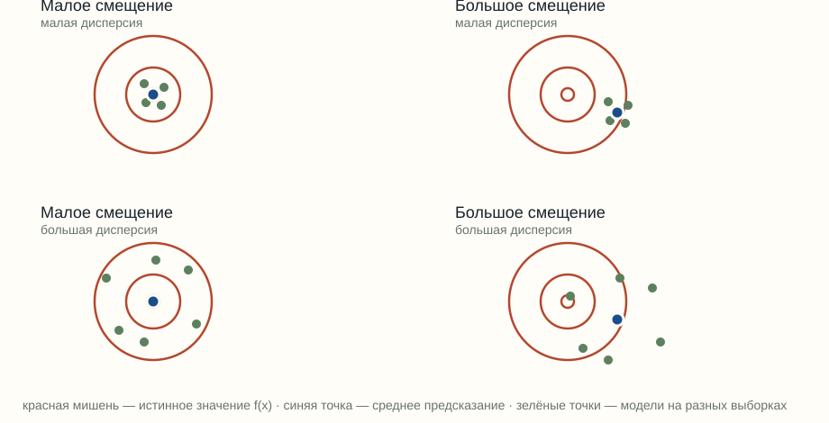
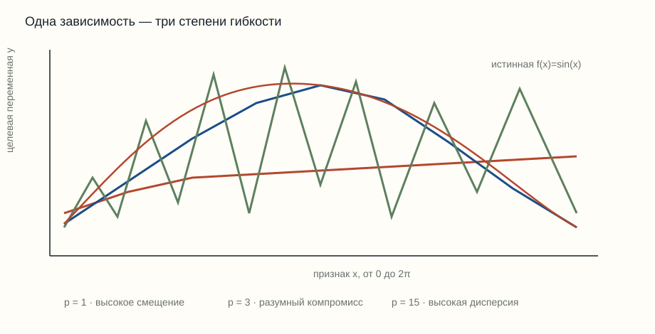
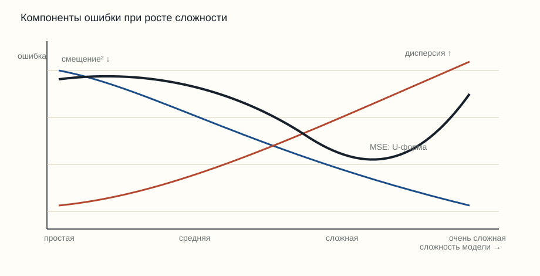

# Разложение смещение–дисперсия

> Материал по теме 4 «Математическая теория обобщения и диагностики моделей». Семинар продолжает разговор о сложности класса функций, радиусе Рэдемахера и обобщении.
>
> Уровень: 1 курс. Основной точный результат ниже относится к квадратичной потере; для других потерь отдельно указаны ограничения.

---

## 1. Сначала зададим функцию потерь

Чтобы измерять ошибку модели, сначала зададим функцию потерь:

Функцию потерь обозначим $\ell(y,\hat y)$. Она показывает численную ошибку прогноза $\hat y$ при истинном значении $y$.

В этом семинаре основной пример — квадратичная потеря:

$$
\ell_2(y,\hat y)=(y-\hat y)^2.
$$

Пусть $H$ — класс допустимых моделей, а $h\in H$ — одна фиксированная модель. Для объекта $x_i$ её прогноз равен $h(x_i)$. Рассмотрим выборку

$$
S=\{(x_1,y_1),\ldots,(x_m,y_m)\}.
$$

Эмпирический риск модели $h$ на этой выборке — средняя потеря по объектам $S$:

$$
\widehat R_S(h)=\frac{1}{m}\sum_{i=1}^{m}\ell\bigl(y_i,h(x_i)\bigr).
$$

Если взять квадратичную потерю, получаем:

$$
\widehat R_S(h)
=\frac{1}{m}\sum_{i=1}^{m}\bigl(y_i-h(x_i)\bigr)^2
=:\mathrm{MSE}_S(h).
$$

Итак, MSE — это частный случай эмпирического риска: это среднее значение **квадратичной функции потерь** на конкретной выборке. Здесь $y_i$ — наблюдаемое значение, $h(x_i)$ — прогноз модели, $m$ — число объектов.

В задачах семинара исходные наблюдения не перечисляются. Вместо них даны компоненты разложения: $b^2$, $v$ и $\sigma_\varepsilon^2$. Поэтому в задачах мы складываем эти компоненты, чтобы получить ожидаемую квадратичную ошибку, и сравниваем полученные значения между моделями.

Эмпирический риск на фиксированной выборке и ожидаемая ошибка — разные величины. Ожидаемая ошибка усредняет потерю по возможным обучающим выборкам и значениям шума; именно её разложение рассматривается далее.

*Рисунок 1. Средняя точка попаданий показывает смещение, разброс попаданий вокруг неё — дисперсию.*

---

## 2. Обозначения и постановка задачи

Рассмотрим одну фиксированную точку признакового пространства $x$. Целевая переменная имеет вид

$$
y = f(x) + \varepsilon,
$$

где $f(x)$ — истинная зависимость, а $\varepsilon$ — случайный шум. Предполагаем, что

$$
\mathbb{E}[\varepsilon]=0,
\qquad
\mathrm{Var}(\varepsilon)=\sigma_\varepsilon^2.
$$

Обучающая выборка обозначается через

$$
S=\{(x_1,y_1),\ldots,(x_m,y_m)\},
$$

где $m$ — число обучающих наблюдений. После обучения на выборке $S$ модель выдаёт предсказание $\hat y_S(x)$ — это и есть «$\hat y$» для данной модели и данной точки $x$. Индекс $S$ напоминает: при другой случайной выборке получится другой прогноз.

Усреднённое предсказание в точке $x$:

$$
\bar y(x)=\mathbb{E}_S[\hat y_S(x)].
$$

Здесь $\mathbb{E}_S$ означает усреднение по случайному выбору обучающей выборки, а не усреднение по новым значениям $x$.

| Обозначение | Смысл |
|---|---|
| $x$ | фиксированное значение признаков, для которого оцениваем ошибку |
| $Y$ | случайное наблюдаемое значение цели в фиксированной точке $x$ |
| $f(x)$ | истинное среднее значение цели без случайного шума |
| $\varepsilon$ | шум, добавленный к $f(x)$ |
| $S$ | обучающая выборка |
| $m$ | размер обучающей выборки |
| $\hat y_S(x)$ | предсказание модели, обученной на $S$ |
| $\bar y(x)$ | среднее предсказание по возможным выборкам |

---

## 3. Точное разложение для квадратичной потери

Рассмотрим одну фиксированную точку признакового пространства $x$. Обозначим случайное наблюдаемое значение цели через $Y$:

$$
Y=f(x)+\varepsilon,
$$

где $f(x)$ — истинное среднее значение цели, а $\varepsilon$ — случайный шум. Предполагаем, что

$$
\mathbb{E}[\varepsilon]=0,
\qquad
\mathrm{Var}(\varepsilon)=\sigma_\varepsilon^2.
$$

Модель, обученная на выборке $S$, выдаёт прогноз $\hat y_S(x)$. Средний прогноз по возможным обучающим выборкам:

$$
\bar y(x)=\mathbb{E}_S[\hat y_S(x)].
$$

Определим смещение и дисперсию:

$$
b(x)=\bar y(x)-f(x),
$$

$$
v(x)=\mathbb{E}_S[(\hat y_S(x)-\bar y(x))^2].
$$

Тогда ожидаемая квадратичная ошибка в фиксированной точке $x$ равна

$$
\mathcal R_2(x)=\mathbb{E}_{S,\varepsilon}[(Y-\hat y_S(x))^2]
$$

и раскладывается так:

$$
\mathcal R_2(x)=b(x)^2+v(x)+\sigma_\varepsilon^2.
$$

Здесь $\mathcal R_2(x)$ — **ожидаемая точечная ошибка**, а не MSE конкретного конечного набора наблюдений. MSE из раздела 1 — эмпирическое среднее по индексам $t$; $\mathcal R_2(x)$ — средняя квадратичная потеря по возможным обучающим выборкам и шумам в одной фиксированной точке $x$.

### Почему равенство выполняется

Начнём с левой части:

$$
\mathcal R_2(x)=\mathbb{E}_{S,\varepsilon}[(Y-\hat y_S(x))^2].
$$

Модель наблюдения говорит, что

$$
Y=f(x)+\varepsilon.
$$

Подставляем $f(x)+\varepsilon$ вместо $Y$ **внутри скобок**, сохраняя квадрат и математическое ожидание:

$$
\mathcal R_2(x)=\mathbb{E}_{S,\varepsilon}[((f(x)+\varepsilon)-\hat y_S(x))^2].
$$

Теперь прибавляем и вычитаем $\bar y(x)$:

$$
(f(x)+\varepsilon)-\hat y_S(x)=\varepsilon+f(x)-\bar y(x)+\bar y(x)-\hat y_S(x).
$$

По определениям $b(x)=\bar y(x)-f(x)$ и

$$
\bar y(x)-\hat y_S(x)=-\bigl(\hat y_S(x)-\bar y(x)\bigr).
$$

Поэтому

$$
(f(x)+\varepsilon)-\hat y_S(x)
=
\varepsilon-b(x)-\bigl(\hat y_S(x)-\bar y(x)\bigr).
$$

Подставляем это выражение обратно под квадрат:

$$
\mathcal R_2(x)=
\mathbb{E}_{S,\varepsilon}[
(\varepsilon-b(x)-\bigl(\hat y_S(x)-\bar y(x)\bigr))^2
].
$$

После раскрытия квадрата перекрёстные слагаемые исчезают при условиях $\mathbb{E}[\varepsilon]=0$, независимости шума и обучающей выборки, а также определения среднего прогноза. Остаются:

$$
\mathbb{E}[\varepsilon^2]=\sigma_\varepsilon^2,
\qquad
\mathbb{E}_S[b(x)^2]=b(x)^2,
$$

$$
\mathbb{E}_S[(\hat y_S(x)-\bar y(x))^2]=v(x).
$$

Следовательно,

$$
\mathcal R_2(x)=b(x)^2+v(x)+\sigma_\varepsilon^2.
$$

### Пример

В точке $x_0$ пусть $b(x_0)^2=4$, $v(x_0)=9$, а $\sigma_\varepsilon^2=1$. Тогда

$$
\mathcal R_2(x_0)=4+9+1=14.
$$

Если цель измеряется в миллионах рублей, это значение имеет единицы $\text{млн}^2$. Среднеквадратичная ошибка в исходных единицах равна $\sqrt{14}\approx 3{,}74$ млн рублей.

---

## 4. Что меняется для произвольной функции потерь

Педру Домингуш (Pedro Domingos) предложил единый взгляд на разложение смещения и дисперсии для разных функций потерь в работе 2000 года. Важна не только сама формула, но и её ограничение: центр предсказаний и смысл «разброса» должны быть согласованы с выбранной потерей.

Для общей функции потерь $L(y,\hat y)$ нельзя без дополнительных условий автоматически записать точное равенство

Нет универсального равенства «ошибка = шум + смещение + дисперсия» для любой функции потерь.

Причина в том, что понятия «среднее предсказание» и «разброс вокруг среднего» зависят от выбранной потери. Для квадратичной потери среднее является естественным центром, и перекрёстные слагаемые сокращаются. Для абсолютной, логарифмической и асимметричных потерь возникают другие центры и дополнительные взаимодействия.

Для общей потери удобно определить два оптимальных ответа:

Здесь $a$ — любой допустимый прогноз, который мы могли бы выдать вместо $y$. Запись $\arg\min$ означает «значение аргумента, на котором выражение достигает минимума». Поэтому $y^*(x)$ — лучший прогноз в точке $x$ с точки зрения выбранной функции потерь. Условное среднее $\mathbb{E}_{y\mid x}$ означает усреднение по возможным значениям цели $y$ при фиксированном значении признаков $x$.

$$
y^*(x)=\arg\min_a\mathbb{E}_{y\mid x}[L(y,a)],
$$

Иными словами, среди всех возможных прогнозов $a$ выбираем тот, у которого ожидаемая потеря минимальна. Этот прогноз называется байесовским оптимальным ответом.

Второй объект определяется похожим образом, но усреднение выполняется по возможным обучающим выборкам:

$$
a^*(x)=\arg\min_a\mathbb{E}_S[L(\hat y_S(x),a)],
$$

где $a^*(x)$ — центр предсказаний моделей с точки зрения той же функции потерь. Здесь $\mathbb{E}_S$ означает усреднение по возможным выборкам $S$.

Эти определения помогают обсуждать шум, систематическое отклонение и разброс, но конкретное аддитивное разложение нужно выводить отдельно для выбранной функции потерь. Формула Домингоса — это семейство разложений, зависящих от функции потерь, а не одна универсальная формула с одинаковыми тремя слагаемыми. Например, при MSE естественным центром является среднее, при абсолютной потере — медиана, а при 0/1-потере нужно рассуждать через вероятности классов.

---

## 5. Бинарная классификация и 0/1-потеря

Для классификации с двумя ответами используем потерю

$$
L_{0/1}(y,\hat y)=
\begin{cases}
0, & y=\hat y,\\
1, & y\neq\hat y.
\end{cases}
$$

В этой ситуации «центральный» ответ и разброс лучше описывать через вероятности классов и вероятности предсказаний, а не через обычное арифметическое среднее меток. Поэтому вклад, называемый variance в разложениях для 0/1-потери, может быть неотрицательным не во всех соглашениях о знаках: часть разброса иногда исправляет систематическую ошибку модели.

Например, если в задаче антифрода доля мошеннических операций равна 5%, а признаки не дают дополнительной информации, постоянный прогноз «не мошенничество» имеет ошибку 5%. Это нижняя граница **при данном информационном ограничении**, а не утверждение, что мошенничество в принципе непредсказуемо.

---

## 6. Связь со сложностью класса функций

Разложение смещение–дисперсия и меры сложности отвечают на разные вопросы.

| Величина | Что она описывает |
|---|---|
| $b(x)^2$ | систематическое отклонение средней модели от $f(x)$ |
| $v(x)$ | изменение предсказания при замене обучающей выборки |
| VC-размерность | ёмкость класса функций в худшем случае |
| $\hat{\mathfrak R}_S(H)$ | способность класса подстроиться под случайные знаки на конкретной выборке $S$ |

VC-размерность и радиус Рэдемахера не вычисляют $b(x)^2$ и $v(x)$ для конкретного алгоритма напрямую. Они дают контроль сложности класса и через неравенства обобщения помогают оценивать зазор между истинным и эмпирическим риском.

Для линейного класса $H$ зададим допустимые функции так:

$$
H=\{h_w: h_w(x)=w^\top x,\ \|w\|_2\le B\}.
$$

Здесь $h_w$ — линейная функция, $x$ — вектор признаков, $w$ — вектор весов, а $B$ ограничивает его евклидову норму. Если $\|x_i\|_2\le R$ и в выборке $m$ объектов, типичная оценка имеет порядок

$$
\hat{\mathfrak R}_S(H)\le\frac{BR}{\sqrt m}.
$$

При ограниченных нормах и росте $m$ класс в среднем хуже подстраивается под случайные знаки.

Усложнение модели часто уменьшает смещение и увеличивает чувствительность к выборке, но это качественная тенденция, а не теорема для любой процедуры обучения. Реальная U-образная кривая ошибки зависит от данных, регуляризации, оптимизатора и выбранной метрики.

---

## 7. Наглядный пример: полиномы разной сложности

Рассмотрим истинную зависимость

$$
f(x)=\sin x,\qquad x\in[0,2\pi],
$$

и наблюдения

$$
y_i=f(x_i)+\varepsilon_i,
\qquad
\varepsilon_i\sim\mathcal N(0,0{,}1^2).
$$

Степень полинома обозначим через $p$.

*Рисунок 2. Линейная модель недообучается, кубическая передаёт форму синусоиды, а полином высокой степени начинает следовать случайным отклонениям.*

При $p=1$ модель слишком негибкая: смещение велико, дисперсия мала. При $p=15$ модель гибкая: смещение на обучающих данных мало, но предсказание чувствительно к тому, какие точки попали в выборку. Степень $p=3$ в данном учебном примере даёт разумный компромисс.

*Рисунок 3. Схематическая U-образная зависимость общей ошибки от сложности модели.*

Числа ниже иллюстративны: они показывают механизм, а не являются универсальными значениями для любой выборки.

| Степень $p$ | $b(x)^2$ | $v(x)$ | $\sigma_\varepsilon^2$ | MSE |
|---:|---:|---:|---:|---:|
| 1 | 0,35 | 0,01 | 0,01 | 0,37 |
| 3 | 0,02 | 0,03 | 0,01 | 0,06 |
| 15 | 0,005 | 0,25 | 0,01 | 0,265 |

---

## 8. Как менять баланс компонентов

| Изменение | Ожидаемый эффект на смещение | Ожидаемый эффект на дисперсию |
|---|---:|---:|
| увеличить степень полинома | уменьшение | увеличение |
| усилить L2-регуляризацию | увеличение | уменьшение |
| добавить информативные признаки | уменьшение | возможное увеличение |
| увеличить объём выборки | обычно почти не меняет | уменьшение |
| использовать бэггинг | обычно почти не меняет | уменьшение |
| увеличить глубину дерева | уменьшение | увеличение |

Фраза «больше данных уменьшает дисперсию как $\frac{1}{m}$» требует конкретной модели и условий. Для учебной интуиции достаточно говорить, что рост $m$ обычно повышает устойчивость оценки; точная скорость зависит от класса функций и распределения данных.

*Рисунок 4. Практическая карта: сначала определить доминирующий компонент, затем выбрать изменение.*

---

## 9. Практические задания

### 9.1. Базовое разложение ожидаемой квадратичной ошибки

В точке $x_0$ известны значения $b(x_0)^2=4$, $v(x_0)=9$ и $\sigma_\varepsilon^2=1$ в квадратных единицах цели. Найдите ожидаемую квадратичную ошибку $\mathcal R_2(x_0)$.

**Решение и ответ.** Используем разложение:

$$
\mathcal R_2(x_0)=b(x_0)^2+v(x_0)+\sigma_\varepsilon^2=4+9+1=14.
$$

Ожидаемая квадратичная ошибка равна 14 в квадратных единицах цели. Если цель измеряется в миллионах рублей, среднеквадратичная ошибка равна $\sqrt{14}\approx 3{,}74$ млн рублей.

### 9.2. Выбор степени полинома

Банк прогнозирует цену квартиры по площади. Для трёх степеней полинома известны компоненты:

| $p$ | $b^2$ | $v$ | $\sigma_\varepsilon^2$ |
|---:|---:|---:|---:|
| 1 | 10 | 1 | 2 |
| 3 | 4 | 4 | 2 |
| 5 | 2 | 8 | 2 |

Какая степень минимизирует ожидаемую квадратичную ошибку?

**Решение и ответ.** Складываем три компонента для каждой модели:

$$
\mathcal R_2^{(1)}=10+1+2=13,
\qquad
\mathcal R_2^{(3)}=4+4+2=10,
\qquad
\mathcal R_2^{(5)}=2+8+2=12.
$$

Минимальная ожидаемую квадратичную ошибку равна 10 при $p=3$.

### 9.3. Регуляризация

После усиления L2-регуляризации $b^2$ выросло с 2 до 8, а $v$ уменьшилось с 16 до 4. Шум равен 1 и не меняется. Сравните ожидаемую квадратичную ошибку до и после.

**Решение и ответ.**

$$
\mathcal R_2^{\text{до}}=2+16+1=19,
\qquad
\mathcal R_2^{\text{после}}=8+4+1=13.
$$

ожидаемую квадратичную ошибку уменьшилась на 6. Регуляризация увеличила смещение, но сильнее уменьшила дисперсию.

### 9.4. Усреднение моделей

Предположим, что усреднение $k$ независимых моделей уменьшает дисперсию в $k$ раз. При $b^2=4$, $v_1=9$, $\sigma_\varepsilon^2=1$ найдите минимальное целое $k$, для которого ожидаемую квадратичную ошибку не превосходит 7.

**Решение и ответ.** После усреднения $v_k=9/k$, поэтому

$$
\mathcal R_{2,k}=4+\frac{9}{k}+1=5+\frac{9}{k}.
$$

Требование $\mathcal R_{2,k}\le 7$ даёт

$$
5+\frac{9}{k}\le 7
\quad\Longrightarrow\quad
k\ge 4{,}5.
$$

Минимальное целое значение — $k=5$. Это идеализированный результат для независимых ошибок.

### 9.5. Доходность и единицы измерения

Дневная доходность имеет шумовую волатильность $\sigma_\varepsilon=2\%$. Дисперсия предсказания равна $0{,}0001$ в долях, а смещение равно нулю. Найдите ожидаемую квадратичную ошибку в долях и среднеквадратичную ошибку в процентах.

**Решение и ответ.** В долях $\sigma_\varepsilon=0{,}02$, поэтому $\sigma_\varepsilon^2=0{,}0004$. Тогда

$$
\mathcal R_2=0+0{,}0001+0{,}0004=0{,}0005.
$$

Среднеквадратичная ошибка:

$$
\mathrm{RMSE}=\sqrt{0{,}0005}\approx 0{,}02236=2{,}236\%.
$$

### 9.6. 0/1-потеря в антифроде

Доля мошеннических операций равна 5%. При отсутствии информативных признаков модель всегда предсказывает «не мошенничество». Какова её ошибка? Какие дополнительные предположения нужны, чтобы назвать эту ошибку байесовским риском?

**Решение и ответ.** Ошибочными будут все мошеннические операции, поэтому

Вероятность ошибки равна 0,05.

Ошибка равна 5%. Чтобы считать её байесовским риском, нужно предположить, что признаки действительно не дают информации о классе и ошибки имеют одинаковую стоимость.

### 9.7. Модели разной сложности

Для прогноза ставки сравниваются три модели:

| Модель | $b^2$ | $v$ | $\sigma_\varepsilon^2$ |
|---|---:|---:|---:|
| AR(1) | 9 | 1 | 4 |
| AR(5) | 4 | 4 | 4 |
| AR(20) | 1 | 16 | 4 |

Какая модель имеет наименьшую ожидаемую квадратичную ошибку? Какой компонент делает AR(20) невыгодной?

**Решение и ответ.**

$$
\mathcal R_2^{\mathrm{AR}(1)}=9+1+4=14,
$$

$$
\mathcal R_2^{\mathrm{AR}(5)}=4+4+4=12,
$$

$$
\mathcal R_2^{\mathrm{AR}(20)}=1+16+4=21.
$$

Наименьшая ожидаемую квадратичную ошибку у AR(5). AR(20) имеет низкое смещение, но слишком большую дисперсию.

### 9.8. Бэггинг

Одно дерево имеет $b^2=5$, $v_1=20$, $\sigma_\varepsilon^2=1$. При идеализированном предположении $v_k=20/k$ найдите минимальное $k$, для которого ожидаемую квадратичную ошибку не превосходит 8.

**Решение и ответ.**

$$
\mathcal R_{2,k}=5+\frac{20}{k}+1=6+\frac{20}{k}.
$$

Условие $\mathcal R_{2,k}\le 8$ даёт $k\ge 10$. Минимально нужно 10 деревьев. В реальности ошибки деревьев могут быть коррелированы.

### 9.9. Неустранимый шум

В страховом прогнозе $b^2=100$, $v=25$, $\sigma_\varepsilon^2=400$. Можно ли получить ожидаемую квадратичную ошибку ниже 425, если класс модели и источник шума не менять?

**Решение и ответ.** Даже если дисперсию удастся уменьшить до нуля, останется

$$
\mathcal R_2^{\min}=100+0+400=500.
$$

Нет, получить ожидаемую квадратичную ошибку ниже 425 нельзя: при фиксированных смещении и шуме минимальный предел равен 500.

### 9.10. Одинаковая ожидаемую квадратичную ошибку, разный диагноз

У банка A $b^2=4$, $v=16$, $\sigma_\varepsilon^2=9$. У банка B $b^2=16$, $v=4$, $\sigma_\varepsilon^2=9$. Сравните ожидаемую квадратичную ошибку и предложите разные действия для двух банков.

**Решение и ответ.**

$$
\mathcal R_2^{(A)}=4+16+9=29,
\qquad
\mathcal R_2^{(B)}=16+4+9=29.
$$

ожидаемую квадратичную ошибку одинаковы. Для банка A доминирует дисперсия: полезны регуляризация, упрощение модели или усреднение. Для банка B доминирует смещение: нужны более выразительная модель или новые признаки.

---

## 10. Словарь терминов

В таблице ниже используются короткие обозначения. Их полные определения приведены отдельными формулами, чтобы они надёжно отображались на GitHub:

$$
\bar y(x)=\mathbb{E}_S[\hat y_S(x)].
$$

$$
v(x)=\mathbb{E}_S[(\hat y_S(x)-\bar y(x))^2].
$$

| Термин | Обозначение | Пояснение |
|---|---|---|
| Истинная функция | $f(x)$ | Средняя зависимость цели от признаков без случайного шума |
| Шум | $\varepsilon$ | Случайное отклонение цели от $f(x)$ |
| Обучающая выборка | $S$ | Набор пар $(x_i,y_i)$, на котором обучается модель |
| Размер выборки | $m$ | Число наблюдений в $S$ |
| Предсказание модели | $\hat y_S(x)$ | Ответ модели в точке $x$, обученной на конкретной выборке $S$ |
| Среднее предсказание | $\bar y(x)$ | Среднее значение прогнозов по возможным обучающим выборкам |
| Смещение | $b(x)$ | $\bar y(x)-f(x)$ |
| Дисперсия предсказания | $v(x)$ | Средний квадрат отклонения прогноза от $\bar y(x)$ по возможным выборкам |
| Функция потерь | $\ell(y,\hat y)$ | Правило, которое сопоставляет истинному значению и прогнозу численную ошибку |
| MSE | $\mathrm{MSE}$ | Эмпирическое среднее квадратичной потери по $T$ наблюдениям |
| Ожидаемая точечная ошибка | $\mathcal R_2(x)$ | Средняя квадратичная потеря в фиксированной точке $x$ по возможным выборкам и шумам |
| Байесовский риск | — | Минимальный достижимый риск при выбранной функции потерь и доступной информации |
| Регуляризация | $\lambda$ | Ограничение сложности модели через дополнительный штраф |
| Бэггинг | — | Усреднение моделей, обученных на разных подвыборках |
| VC-размерность | $h$ | Мера ёмкости класса функций в худшем случае |
| Радиус Рэдемахера | $\hat{\mathfrak R}_S(H)$ | Мера способности класса $H$ подстраиваться под случайные знаки на выборке $S$ |
| Компромисс смещение–дисперсия | — | Ситуация, в которой уменьшение одного компонента может увеличивать другой |

---

## Литература

1. Domingos P. (2000). *A unified bias-variance decomposition and its applications*. ICML.
2. Geman S., Bienenstock E., Doursat R. (1992). *Neural networks and the bias/variance dilemma*. Neural Computation, 4(1), 1–58.
3. Hastie T., Tibshirani R., Friedman J. (2009). *The Elements of Statistical Learning*. Springer.
4. Shalev-Shwartz S., Ben-David S. (2014). *Understanding Machine Learning*. Cambridge University Press.
5. Bishop C. (2006). *Pattern Recognition and Machine Learning*. Springer.
